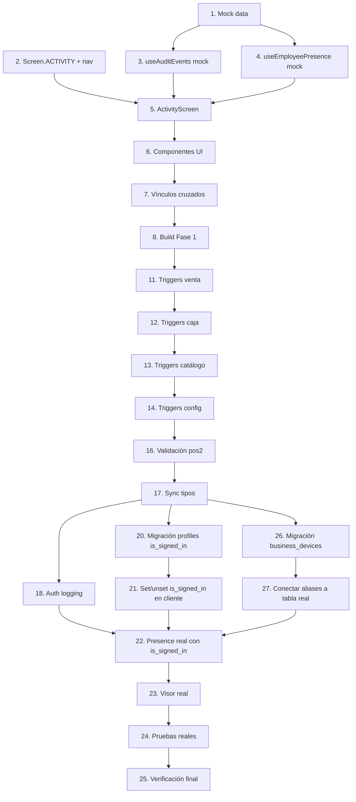

# Implementation Plan

## Overview

Plan de implementación para "actividad de empleados": presencia en tiempo real + visor de eventos (tabla `audit_events` poblada por triggers tolerantes a fallos y un logger de auth), con pantalla nueva `Screen.ACTIVITY` y vínculos cruzados al Reporte de Empleado.

> **Estrategia de implementación (decisión del usuario):**
> 1. **Fase 1 — Frontend con datos de prueba**: se construye toda la UI (pantalla, pestañas, presencia, visor, filtros, detalle, vínculos) alimentada por un módulo de **datos mock** (`lib/activityMockData.ts`). Esto se desarrolla en una rama aparte y **no afecta producción**. Objetivo: poder ver y validar la experiencia completa sin tocar la base de datos real.
> 2. **Fase 2 — Backend en Supabase (DIFERIDA al final)**: triggers en tablas vivas, logger de auth y retención. Se aplica directo a `pos2` (opción B) solo cuando el frontend esté validado, para minimizar el tiempo de exposición a riesgo en producción. Cada trigger es tolerante a fallos por diseño.
> 3. **Fase 3 — Conexión real**: se cambian los hooks de "modo mock" a consultas reales de Supabase y se verifica no-regresión.
>
> **Estado actual de backend**: las tareas 9 y 10 (tabla `audit_events` y función `log_audit_event`) YA se aplicaron a `pos2`. Son inofensivas: la tabla está vacía y aislada, y la función no es invocable por clientes ni está conectada a ningún trigger. No afectan ninguna operación de producción.

## Tasks

### Fase 1 — Frontend con datos de prueba (sin tocar producción)

- [x] 1. Crear `lib/activityMockData.ts` con datos de prueba
  - Lista mock de empleados conectados (estados `activo`/`inactivo`/`desconectado`, con/sin caja abierta)
  - Lista mock de `audit_events` cubriendo todas las categorías y severidades, con metadata realista (`sale_id`, `before`/`after`, `device_label`, etc.) y al menos un evento de "cuenta archivada"
  - Tipos TypeScript compartidos (`AuditEvent`, `PresenceUser`) que reflejen el esquema real de la tabla
  - _Requirements: 4.3, 5.3, 15.3_

- [x] 2. Agregar `Screen.ACTIVITY` y cableado de navegación/permisos
- [x] 2.1 Añadir `ACTIVITY = 'ACTIVITY'` al enum `Screen` en `types.ts`
  - _Requirements: 1.1, 4.1_
- [x] 2.2 Caso `Screen.ACTIVITY` en `usePermissions.canAccessScreen` → `admin_users || admin_settings || isSuperAdmin`
  - _Requirements: 1.4, 4.4_
- [x] 2.3 Render condicional en `App.tsx` e ítem "Actividad" en `components/Sidebar.tsx` (revisar mapa de `App.tsx` antes de editar)
  - _Requirements: 1.1_

- [x] 3. Crear `hooks/useAuditEvents.ts` en modo mock
  - Lee de `activityMockData`; expone interfaz lista para cambiar a Supabase en Fase 3
  - Paginación (50/bloque, "Cargar más"); filtros: fecha (presets + rango), empleado, categoría, severidad, búsqueda libre
  - Default 90 días; aviso si el rango excede 90 días; reinicio de paginación al cambiar filtro; persistencia de filtros en query string
  - _Requirements: 4.1, 4.2, 5.1, 5.2, 5.3, 5.4, 5.5, 5.6, 5.7, 16.2, 16.4_

- [x] 4. Crear `hooks/useEmployeePresence.ts` en modo mock
  - Devuelve la lista mock; deriva estado `activo`/`inactivo`/`desconectado`; interfaz lista para Realtime en Fase 3
  - Indicador "Sin conexión"; preserva última lista conocida
  - _Requirements: 1.1, 1.2, 1.3, 1.5, 2.1, 2.2, 2.3, 2.4, 2.5, 2.6_

- [x] 5. Crear `screens/ActivityScreen.tsx` con dos pestañas
  - "Empleados conectados" (usa `useEmployeePresence`) y "Visor de eventos" (usa `useAuditEvents`); esqueleto de carga; sin pantalla en blanco
  - _Requirements: 1.1, 4.3, 4.5_

- [x] 6. Componentes de presentación
- [x] 6.1 `components/activity/PresenceList.tsx` (tarjetas <768px, filas en desktop)
  - Avatar, nombre, rol, pantalla, tiempo desde login, estado, distintivo "Caja abierta"
  - _Requirements: 1.2, 2.6, 18.1, 18.4_
- [x] 6.2 `components/activity/EventRow.tsx` y `EventFilters.tsx`
  - Timestamp (tz negocio vía `lib/timezone.ts`), usuario, categoría, acción en español, severidad con color; distintivos "Cuenta archivada"/"Cuenta eliminada"
  - _Requirements: 4.3, 15.3, 18.1, 18.2, 18.3_
- [x] 6.3 `components/activity/EventDetailModal.tsx`
  - Metadata completa (`user_agent, device_id, device_label, before/after, sale_id, cash_shift_id`); IP omitida si ausente
  - _Requirements: 6.1_

- [x] 7. Vínculos cruzados (navegación UI, con datos de prueba)
  - "Ver venta" (con `sale_id`) → `SalesScreen`; "Ver reporte de este empleado" → Reporte; "Filtrar por este empleado"
  - Botón "Ver eventos de este empleado" en `EmployeeReportActionsModal.tsx` → `Screen.ACTIVITY` con filtros pre-cargados
  - _Requirements: 6.2, 6.3, 6.4, 6.5, 17.1_

- [x] 8. Revisión visual y build de Fase 1
  - `npm run build` sin errores; revisar la pantalla con datos de prueba en desktop y <768px
  - _Requirements: 18.1, 18.3, 18.4_

### Fase 2 — Backend en Supabase (DIFERIDA al final, producción · opción B, uno por uno)

- [x] 9. Crear tabla `audit_events`, índices y RLS *(ya aplicada a `pos2`; inofensiva)*
  - _Requirements: 13.1, 13.4, 16.1, 16.3_

- [x] 10. Crear función central `log_audit_event` (SECURITY DEFINER, tolerante a fallos) *(ya aplicada; no invocable por clientes)*
  - _Requirements: 12.1, 13.1, 14.1_

- [x] 11. Triggers de operación de venta (tolerantes a fallos) — ⏸️ pausar y verificar producción tras cada uno
- [x] 11.1 Trigger `audit_orders_void` en `orders` (AFTER UPDATE, solo `status`→`voided`)
  - _Requirements: 8.1_
- [x] 11.2 Trigger `audit_order_item_void` en `order_items` (AFTER UPDATE, solo `status`→`canceled`)
  - _Requirements: 8.2_
- [x] 11.3 Trigger `audit_refund_insert` en `sale_refunds` (AFTER INSERT)
  - _Requirements: 8.3_
- [x] 11.4 Verificar que ventas `completed` sin anulación/devolución NO generan eventos
  - _Requirements: 8.4, 17.2_

- [x] 12. Triggers de caja, mermas y gastos — ⏸️ pausar y verificar
- [x] 12.1 `audit_shift_open` / `audit_shift_close` en `cash_shifts` (warning si |difference| > 5000)
  - _Requirements: 9.1, 9.2_
- [x] 12.2 `audit_wastage_insert` en `wastage`
  - _Requirements: 9.3_
- [x] 12.3 `audit_expense_insert` en `expenses`
  - _Requirements: 9.4_

- [x] 13. Triggers de catálogo y promociones — ⏸️ pausar y verificar
- [x] 13.1 `audit_product_price` en `products` (cuando `price` cambia)
  - _Requirements: 11.1, 11.4_
- [x] 13.2 `audit_product_create` / `audit_product_deactivate` en `products`
  - _Requirements: 11.2, 11.3_
- [x] 13.3 `audit_promotion_change` en `promotions`
  - _Requirements: 11.5_

- [x] 14. Triggers de configuración, permisos y usuarios — ⏸️ pausar y verificar
- [x] 14.1 `audit_business_config` en `businesses` (`business.changed` / `printer.changed`)
  - _Requirements: 10.1, 10.2, 14.4_
- [x] 14.2 `audit_role_permissions` en `roles`
  - _Requirements: 10.3_
- [x] 14.3 `audit_profile_user` en `profiles` (create / archive / role change / permissions change)
  - _Requirements: 10.3, 10.4, 10.5, 10.6, 15.1_

- [x] 15. Función de retención (disponible, no programada)
  - _Requirements: 16.3_

- [x] 16. Validación de no-regresión en `pos2` (post-migración)
  - Venta normal, anular, abrir/cerrar caja, merma, gasto; confirmar operación normal + evento esperado
  - Forzar fallo dentro de un trigger y confirmar que la operación de negocio NO se aborta
  - `get_advisors` (security + performance)
  - _Requirements: 12.1, 8.4, 17.4_

- [ ] 17. Sincronizar migraciones y tipos al workspace (`migration fetch`, `gen types`)
  - _Requirements: 13.1_

- [x] 18. Auditoría de autenticación
  - RPC `log_auth_event(action, metadata)` SECURITY DEFINER que deriva `business_id`/`user_id` del JWT; `lib/auditClient.ts`; integrar `login.success`/`logout` en `context/AuthContext.tsx`
  - _Requirements: 7.1, 7.2, 7.3, 14.1, 14.3_

- [ ] 19. Registrar `pin.changed` en edge function `change-pin` (sin el PIN, try/catch); redeploy
  - _Requirements: 7.4, 14.1_

- [x] 20. Migración: columnas de presencia en `profiles`
  - `ALTER TABLE profiles ADD is_signed_in boolean DEFAULT false`, `last_login_at timestamptz`, `last_logout_at timestamptz`; índice `(business_id, is_signed_in)`
  - Aditivo: `is_signed_in` arranca en false para todos los empleados existentes (ningún login activo de antes se ve afectado)
  - _Requirements: 2.1, 3.1, 3.5_

- [x] 21. Lógica de set/unset de `is_signed_in` en cliente
  - En `AuthContext`: tras login exitoso, `UPDATE profiles SET is_signed_in=true, last_login_at=now()`
  - En `signOut()`: ANTES de `auth.signOut()`, `UPDATE profiles SET is_signed_in=false, last_logout_at=now()`
  - En `auth.onAuthStateChange === 'SIGNED_OUT'`: mismo update por si expira el JWT
  - _Requirements: 2.5, 3.1, 3.5, 3.8_

### Fase 3 — Conexión real y cierre

- [x] 22. Conectar `useEmployeePresence` a Supabase Realtime Presence + cruce con `profiles.is_signed_in`
  - `hooks/usePresenceBroadcast.ts` (canal `presence:business-{id}`, `worker: true`, `heartbeatCallback` para reconectar; tracker de actividad humana con throttle 30s; untrack en logout)
  - El hook listará todos los empleados con `is_signed_in=true` del negocio y cruzará con `presenceState()` para clasificar (Activo / Inactivo / Desconectado según las reglas del Req 2)
  - Suscribirse a `postgres_changes` en `profiles.is_signed_in` para detectar logouts/expiraciones
  - Quitar modo mock
  - _Requirements: 2.1, 2.2, 2.3, 2.4, 2.5, 3.1, 3.2, 3.3, 3.6_

- [x] 23. Conectar `useAuditEvents` a la tabla real `audit_events` (quitar modo mock)
  - _Requirements: 4.1, 16.2_

- [ ] 24. Pruebas de presencia y visor con datos reales
  - Dos sesiones simultáneas: transiciones de estado; visor: filtros, paginación, RLS (aislamiento entre negocios), responsive <768px
  - _Requirements: 1.3, 2.5, 5.6, 13.1, 18.3_

- [ ] 25. Verificación final de no-regresión y build
  - Flujo completo de POS sin cambios de comportamiento; `npm run build` sin errores; coexistencia reporte ↔ visor
  - _Requirements: 17.1, 17.4, 17.5_

- [x] 26. Migración: tabla `business_devices` (alias de dispositivos)
  - El frontend ya consume el modelo a través de `lib/deviceAliasStore.ts` con mock en localStorage. Esquema completo en `STATUS.md`.
  - `CREATE TABLE business_devices (device_id uuid PK, business_id uuid FK, alias text, default_label text, user_agent text, device_type text, first_seen_at, last_seen_at)`
  - RLS: SELECT/INSERT/UPDATE solo para usuarios del mismo business_id
  - Aditivo, no afecta nada existente
  - _Requirements: 1.2 (identificador de dispositivo legible)_

- [x] 27. Conectar `useDeviceAliases` a la tabla real `business_devices` (quitar mock localStorage)
  - Mantener la misma interfaz pública del hook; cambiar fuente del store de localStorage a Supabase
  - `upsertSeen` se llama desde `usePresenceBroadcast` cuando el cliente se une al canal
  - _Requirements: 1.2_

## Notes

- **Frontend primero, backend al final**: la UI se construye con datos de prueba (`lib/activityMockData.ts`) para no depender de producción. Solo en Fase 3 se conectan datos reales.
- Cada función de trigger (Fase 2) envuelve su lógica en `EXCEPTION WHEN OTHERS THEN RAISE WARNING`: un fallo de auditoría nunca aborta una operación de negocio.
- Triggers nuevos usan prefijo `audit_` para no colisionar con los existentes.
- No se modifican tablas, datos, RLS ni triggers existentes; todo es aditivo.
- La auditoría offline se logra porque la sincronización de la cola escribe en las tablas y dispara los mismos triggers.
- Los hooks de Fase 1 exponen la misma interfaz que usará la versión real, para que el cambio mock→real en Fase 3 sea mínimo.

## Task Dependency Graph

```json
{
  "waves": [
    { "wave": 1, "tasks": ["1", "2"] },
    { "wave": 2, "tasks": ["3", "4"] },
    { "wave": 3, "tasks": ["5"] },
    { "wave": 4, "tasks": ["6"] },
    { "wave": 5, "tasks": ["7"] },
    { "wave": 6, "tasks": ["8"] },
    { "wave": 7, "tasks": ["11", "12", "13", "14"] },
    { "wave": 8, "tasks": ["15", "16"] },
    { "wave": 9, "tasks": ["17", "18", "19", "20", "26"] },
    { "wave": 10, "tasks": ["21", "22", "23", "27"] },
    { "wave": 11, "tasks": ["24"] },
    { "wave": 12, "tasks": ["25"] }
  ]
}
```

> Nota: tareas 9 y 10 ya aplicadas (no aparecen en olas pendientes). La ola 7 (triggers) es la de riesgo en producción y se ejecuta una por una con verificación.



