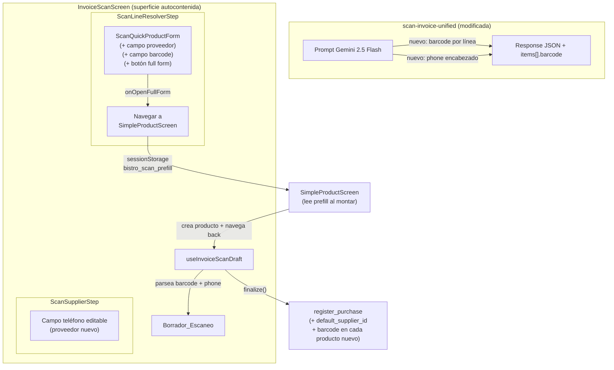

# Documento de Diseño: Creación de Productos desde Factura IA

## Overview

Este spec extiende el flujo de escaneo unificado de facturas (spec `escaneo-factura-unificado`) con cinco mejoras puntuales a la creación rápida de productos:

1. **Extracción de código de barras por línea** — el prompt de `scan-invoice-unified` se amplía para extraer el EAN/UPC de cada línea cuando la factura lo incluye.
2. **Campo de proveedor prellenado** — `ScanQuickProductForm` muestra el proveedor del encabezado como dato no editable, y el borrador conserva la asociación para asignar `default_supplier_id` en la finalización.
3. **Campo de código de barras** — prellenado con el dato de la IA, editable, con escaneo manual sin búsqueda externa.
4. **Extracción de teléfono del proveedor** — el prompt extrae el teléfono del encabezado y el `ScanSupplierStep` lo muestra editable en el aviso de proveedor nuevo.
5. **Abrir formulario completo** — botón que navega a `SimpleProductScreen` con datos prellenados vía `sessionStorage`, crea el producto inmediatamente y regresa al resolutor.

### Decisiones de diseño clave

| Decisión | Justificación |
|----------|---------------|
| Modificar `scan-invoice-unified` (no `scan-invoice` v30) | El prompt del escaneo embebido (`scan-invoice`) no se toca durante esta iteración; la función nueva del spec unificado ya incluye barcode y phone |
| `sessionStorage` para prellenar `SimpleProductScreen` | Patrón ya establecido en el proyecto (`bistro_create_product_as_insumo`, `bistro_payment_skip_summary`). Evita props drilling o contextos globales nuevos |
| Escaneo de barcode sin lookup | El producto es nuevo — buscar en Go-UPC/Google CSE no aporta valor y confunde al usuario. Solo se valida formato |
| Advertencia de duplicado barcode: consulta local al catálogo ya cargado | El `ScanLineResolverStep` ya recibe el catálogo completo por prop; la verificación es un `find` en memoria, sin fetch adicional |
| Proveedor nuevo se crea antes de navegar a `SimpleProductScreen` | `SimpleProductScreen` necesita un `supplier_id` real para asignar `default_supplier_id` en su propio `INSERT`. Crear el proveedor en la sesión garantiza que existe aunque el usuario cancele la factura después |

## Architecture



### Flujo de datos del código de barras

```
scan-invoice-unified
  └─ items[i].barcode: "7702011234567" | ""
       │
       ▼
useInvoiceScanDraft.parseScanResponse()
  └─ ScanLine.barcode = items[i].barcode
       │
       ▼
ScanLineResolverStep
  └─ pasa barcode a ScanQuickProductForm como prop `defaultBarcode`
       │
       ├─ Usuario acepta → NewProductDraft.barcode = valor editado
       │     └─ Borrador_Escaneo guarda barcode en la decisión `created`
       │           └─ register_purchase → INSERT products con barcode
       │
       └─ Usuario abre formulario completo → sessionStorage con barcode
             └─ SimpleProductScreen lee, crea producto inmediatamente con barcode
                   └─ regresa al Resolutor con línea vinculada al producto creado
```

### Flujo de datos del proveedor en creación rápida

```
useInvoiceScanDraft.supplierDecision
  └─ { kind: 'confirmed', id, name } | { kind: 'new', name, nit, phone }
       │
       ▼
ScanLineResolverStep
  └─ pasa supplierInfo a ScanQuickProductForm
       │
       ├─ Formulario rápido: NewProductDraft no incluye supplier
       │     └─ Borrador conserva el supplier por separado (ya existía)
       │           └─ register_purchase asigna default_supplier_id
       │
       └─ Formulario completo: sessionStorage incluye supplierId
             └─ SimpleProductScreen hace INSERT con default_supplier_id
```

## Components and Interfaces

### Archivos modificados

| Archivo | Cambio |
|---------|--------|
| `supabase/functions/scan-invoice-unified/index.ts` | Ampliar prompt: extraer `barcode` por línea y `phone` del encabezado |
| `lib/invoiceScan/types.ts` | Agregar `barcode` a `ScanLine` y `NewProductDraft`; agregar `phone` a `ScanSupplierDraft` |
| `hooks/useInvoiceScanDraft.ts` | Parsear `barcode` y `phone` del response; incluir barcode en el payload de `register_purchase` |
| `components/invoiceScan/ScanQuickProductForm.tsx` | Agregar campo proveedor (readonly), campo barcode (editable + scan button), botón "Abrir formulario completo" |
| `components/invoiceScan/ScanLineResolverStep.tsx` | Pasar `defaultBarcode` y `supplierInfo` a `ScanQuickProductForm`; manejar `onOpenFullForm` |
| `components/invoiceScan/ScanSupplierStep.tsx` | Mostrar campo `phone` editable en el aviso de proveedor nuevo |
| `screens/InvoiceScanScreen.tsx` | Manejar navegación a `SimpleProductScreen` y retorno |
| `screens/SimpleProductScreen.tsx` | Leer `sessionStorage` de prefill al montar (nombre, costo, barcode, supplier, isForSale) |
| `lib/invoiceScan/buildPurchasePayload.ts` | Incluir `barcode` y `default_supplier_id` en cada producto nuevo del payload |

### Archivos nuevos

| Archivo | Responsabilidad |
|---------|-----------------|
| `lib/invoiceScan/barcodeValidation.ts` | `isValidBarcode(code: string): boolean` — valida formato (vacío o 8-14 dígitos) |

### Interfaces modificadas

#### `ScanLine` (en `lib/invoiceScan/types.ts`)

```ts
export interface ScanLine {
    // ... campos existentes ...
    /** Codigo_Barras_Linea extraído por la edge function. Cadena vacía si no hay. */
    barcode: string;
}
```

#### `NewProductDraft` (en `lib/invoiceScan/types.ts`)

```ts
export interface NewProductDraft {
    name: string;
    categoryId: string;
    unit: string;
    cost: number;
    price: number;
    isForSale: boolean;
    /** Código de barras del producto (vacío si no se ingresó). Nuevo campo. */
    barcode: string;
}
```

#### `ScanSupplierDraft` (en `lib/invoiceScan/types.ts`)

```ts
export type ScanSupplierDraft =
    | { kind: 'confirmed'; id: string; name: string }
    | { kind: 'new'; name: string; nit: string; phone: string };
```

#### `ScanQuickProductFormProps` (en `ScanQuickProductForm.tsx`)

```ts
export interface ScanQuickProductFormProps {
    // ... props existentes (ocrName, defaultCost, categories, products, onCreate, onLinkExisting) ...

    /** Codigo_Barras_Linea de la IA, para prellenar el campo. */
    defaultBarcode: string;
    /** Info del proveedor confirmado/nuevo para mostrar readonly. */
    supplierInfo: { name: string; isNew: boolean };
    /** Navegar al formulario completo con datos prellenados. */
    onOpenFullForm: (partialDraft: QuickFormPartialDraft) => void;
}

/** Datos que el formulario rápido pasa al iniciar la navegación al completo. */
export interface QuickFormPartialDraft {
    name: string;
    cost: number;
    barcode: string;
    isForSale: boolean;
    categoryId: string;
    unit: string;
}
```

#### Contrato de `sessionStorage` para prellenar `SimpleProductScreen`

Clave: `bistro_scan_prefill`

```ts
interface ScanPrefillData {
    name: string;
    cost: number;
    barcode: string;
    supplierId: string | null;    // null si el proveedor no se creó aún
    supplierName: string;
    isForSale: boolean;
    /** Flag para que SimpleProductScreen sepa que viene del escaneo */
    fromScan: true;
    /** ID de la línea en el borrador, para vincular al regresar */
    scanLineId: string;
}
```

`SimpleProductScreen` lee y consume (elimina) esta clave en un `useEffect` al montar. Si `fromScan` es `true`, ajusta su comportamiento:
- Omite lookup de barcode (Go-UPC, Google CSE, duplicate check on type).
- Al guardar: crea inmediatamente, almacena el producto creado en `sessionStorage` con clave `bistro_scan_product_created` y navega back.
- Al cancelar: navega back sin escribir en `sessionStorage`.

`InvoiceScanScreen` lee `bistro_scan_product_created` al recuperar el foco y vincula la línea.

#### Respuesta ampliada de `scan-invoice-unified`

```jsonc
{
  "header": {
    "supplierName": "DISTRIBUIDORA X SAS",
    "nit": "900123456-7",
    "phone": "3101234567",         // NUEVO: teléfono del proveedor, "" si no hay
    "invoiceNumber": "F-00123",
    "date": "2026-08-01"
  },
  "document": { "globalDiscount": 5000, "documentTotal": 240000 },
  "items": [
    {
      "description": "BONYURT CHOCOKRISPIS CJ X 6",
      "quantity": 2,
      "ocr_unit": "CJ",
      "unitValue": 12000,
      "lineSubtotal": 24000,
      "lineTax": 4560,
      "lineDiscount": 2000,
      "lineNetTotal": 26560,
      "barcode": "7702011234567"   // NUEVO: código de barras, "" si no hay
    }
  ]
}
```

### Componente `BarcodeScanner` — Reutilización

El formulario rápido reutiliza `<BarcodeScanner onScan={handleScan} onClose={handleClose} />` con la misma interfaz que usa `SimpleProductScreen`. La diferencia está en el callback `handleScan`:

- **En `SimpleProductScreen`**: `handleBarcodeScan` → `setBarcode` + `handleBarcodeLookup` (consulta duplicados, Go-UPC, Google CSE).
- **En `ScanQuickProductForm`**: `handleBarcodeScan` → `setBarcode` solamente. Sin ninguna llamada de red.

No se necesita modificar `BarcodeScanner.tsx`.

## Data Models

### Cambios en el payload de `register_purchase`

El payload JSON que recibe la RPC `register_purchase` se extiende en la sección de productos nuevos:

```ts
// Dentro del payload p_payload → new_products[]
interface PurchaseNewProduct {
    // ... campos existentes (name, category_id, unit, cost, price, is_for_sale) ...
    barcode: string | null;              // NUEVO
    default_supplier_id: string | null;  // NUEVO (se resuelve dentro del RPC si el proveedor es nuevo)
}
```

La RPC `register_purchase` ya crea proveedores nuevos (spec unificado, paso dentro de la transacción). El `default_supplier_id` se asigna con el `id` del proveedor (existente o recién creado) al hacer el `INSERT INTO products`.

### Cambios en `suppliers` (lectura)

Se lee `suppliers.phone` para comparación (Req 6.6) pero NO se actualiza si el proveedor ya existe. Solo se escribe `phone` cuando se crea un proveedor nuevo.

### Tabla `product_purchase_units` — sin cambios

Este spec no toca la lógica de unidades de compra.

### `sessionStorage` — Datos efímeros

| Clave | Productor | Consumidor | Ciclo de vida |
|-------|-----------|------------|---------------|
| `bistro_scan_prefill` | `InvoiceScanScreen` (al navegar a SimpleProductScreen) | `SimpleProductScreen` (al montar) | Se elimina al leer |
| `bistro_scan_product_created` | `SimpleProductScreen` (al guardar desde scan) | `InvoiceScanScreen` (al recuperar foco) | Se elimina al leer |

Ambas claves se eliminan inmediatamente al ser consumidas. Si el usuario cierra el navegador entre medio, no hay efecto residual (la línea queda pendiente en el borrador en memoria, que también se pierde).

## Error Handling

| Escenario | Comportamiento |
|-----------|----------------|
| Edge function no devuelve `barcode` en alguna línea | El parser trata `undefined` como `""` (cadena vacía). El campo aparece vacío en el formulario |
| Edge function no devuelve `phone` en el header | El parser trata `undefined` como `""`. El campo de teléfono no se muestra en el aviso de proveedor nuevo |
| Barcode ingresado no pasa validación (no es 8-14 dígitos) | Se muestra error inline debajo del campo. El botón "Crear y continuar" permanece habilitado (barcode es opcional) pero el valor inválido no se guarda: se almacena como `""` |
| `SimpleProductScreen` falla al crear el producto (error de red, RLS, etc.) | Se muestra el toast de error existente. El usuario puede reintentar o cancelar. Al cancelar regresa al Resolutor con la línea pendiente |
| `sessionStorage` no disponible (modo privado Safari en versiones antiguas) | Try/catch alrededor de `setItem`/`getItem`. Si falla, el botón "Abrir formulario completo" se oculta y se registra un warning en consola |
| Proveedor nuevo falla al crearse antes de navegar a `SimpleProductScreen` | Se muestra toast de error. El usuario permanece en el Resolutor. Puede reintentar o usar la creación rápida sin formulario completo |
| Barcode duplicado: producto existente tiene el mismo código | Se muestra advertencia con el nombre del producto existente. El usuario puede continuar (se permite barcode compartido) o corregir el valor |

## Correctness Properties

*Una propiedad es una característica o comportamiento que debe ser verdadero en todas las ejecuciones válidas del sistema — esencialmente, una declaración formal sobre lo que el sistema debe hacer. Las propiedades sirven como puente entre especificaciones legibles por humanos y garantías de corrección verificables por máquina.*

### Property 1: Validación de código de barras

*Para cualquier* cadena de entrada, la función `isValidBarcode` retorna `true` si y solo si la cadena es vacía o contiene exclusivamente entre 8 y 14 dígitos numéricos. Para toda otra cadena (con letras, símbolos, menos de 8 dígitos, más de 14 dígitos), retorna `false`.

**Validates: Requirements 1.3, 4.6**

### Property 2: Escaneo de barcode sin efectos de red

*Para cualquier* código de barras detectado por el `BarcodeScanner` o escrito manualmente dentro de `ScanQuickProductForm`, el componente NO invoca consultas a la base de datos, Go-UPC API ni Google Custom Search. El único efecto es establecer el valor en el estado local del campo.

**Validates: Requirements 4.2, 4.4, 4.5**

### Property 3: Round-trip de barcode en el borrador

*Para cualquier* valor de barcode que pasa la validación (vacío o 8-14 dígitos), si el usuario acepta la `Creacion_Rapida_Producto`, el `NewProductDraft` resultante contiene exactamente ese valor en su campo `barcode`. El borrador no muta ni descarta el código.

**Validates: Requirements 3.4, 3.5**

### Property 4: Detección de barcode duplicado

*Para cualquier* catálogo de productos del Negocio_Activo y cualquier código de barras no vacío ingresado en el formulario rápido, si existe al menos un producto activo en el catálogo con ese mismo barcode, el formulario muestra una advertencia con el nombre del producto existente.

**Validates: Requirements 3.6**

### Property 5: Completitud del transfer de datos al formulario completo

*Para cualquier* estado del formulario rápido con campos nombre, costo, barcode, categoría, unidad e isForSale, al invocar "Abrir formulario completo", el payload escrito en `sessionStorage` contiene todos esos campos con sus valores actuales (no los valores iniciales/default).

**Validates: Requirements 5.3**

### Property 6: Asociación de proveedor en la creación rápida

*Para cualquier* línea de factura resuelta con "Crear producto rápido" cuando existe un `supplierDecision` confirmado o nuevo en el borrador, el payload enviado a `register_purchase` incluye el `default_supplier_id` correspondiente para ese producto nuevo.

**Validates: Requirements 2.5**

## Testing Strategy

### Enfoque dual

- **Tests unitarios** (Vitest): verifican ejemplos específicos, edge cases y rendering de componentes.
- **Tests de propiedad** (fast-check + Vitest): verifican propiedades universales con 100+ iteraciones por propiedad.

### Tests de propiedad (fast-check)

Biblioteca: `fast-check` (ya presente como dependencia de desarrollo en el proyecto).

Configuración: mínimo 100 iteraciones por test.

| Propiedad | Archivo de test | Qué genera |
|-----------|-----------------|-------------|
| Property 1: Validación barcode | `lib/invoiceScan/barcodeValidation.test.ts` | Cadenas arbitrarias (ascii, unicode, numéricas de largo variable) |
| Property 2: Sin lookup en scan | `components/invoiceScan/ScanQuickProductForm.test.tsx` | Códigos de barras aleatorios pasados al callback `onScan` |
| Property 3: Round-trip barcode | `components/invoiceScan/ScanQuickProductForm.test.tsx` | Códigos válidos (8-14 dígitos) y cadena vacía |
| Property 4: Duplicado barcode | `components/invoiceScan/ScanQuickProductForm.test.tsx` | Catálogos con N productos con barcodes aleatorios + código ingresado que es uno de ellos |
| Property 5: Transfer al full form | `components/invoiceScan/ScanQuickProductForm.test.tsx` | Combinaciones de campos del formulario (nombres, costos, barcodes, flags) |
| Property 6: Supplier en payload | `lib/invoiceScan/buildPurchasePayload.test.ts` | Borradores con proveedor confirmado o nuevo + líneas con decisión `created` |

Tag de cada test: `/** Feature: creacion-productos-factura-ia, Property N: [texto] */`

### Tests unitarios (ejemplo-basados)

| Área | Archivo | Casos |
|------|---------|-------|
| Rendering proveedor readonly | `ScanQuickProductForm.test.tsx` | Proveedor existente muestra nombre; proveedor nuevo muestra badge "Nuevo" |
| Prellenado barcode | `ScanQuickProductForm.test.tsx` | `defaultBarcode="770..."` → campo tiene valor; `defaultBarcode=""` → campo vacío |
| Botón "Abrir formulario completo" | `ScanQuickProductForm.test.tsx` | Existe, llama `onOpenFullForm` con datos actuales |
| `SimpleProductScreen` lee prefill | `SimpleProductScreen.test.tsx` | Con `bistro_scan_prefill` en sessionStorage, campos se poblan; sin él, comportamiento normal |
| Teléfono en ScanSupplierStep | `ScanSupplierStep.test.tsx` | Proveedor nuevo con phone → campo editable; sin phone → sin campo; proveedor existente → sin campo |
| Prompt de edge function | Test manual / integration | Verifica que la respuesta incluye `barcode` y `phone` con facturas reales |

### Tests de integración

| Escenario | Método |
|-----------|--------|
| Extracción de barcode desde factura real | Test E2E contra función desplegada con imágenes de prueba |
| `register_purchase` con `barcode` y `default_supplier_id` | Test RPC contra BD de desarrollo |
| Creación de proveedor antes de `SimpleProductScreen` | Test E2E del flujo completo |
