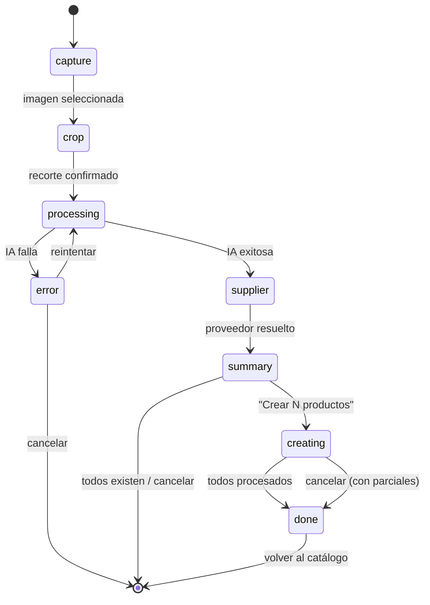

# Documento de Diseño: Crear Productos desde Factura

## Overview

Esta feature implementa un flujo independiente del escaneo unificado de compras. El objetivo es **poblar el catálogo** de productos a partir de una factura escaneada con IA, sin generar ningún movimiento financiero ni de inventario.

El flujo se orquesta como una máquina de estados dentro de un nuevo `InvoiceCreateScreen`. Reutiliza los componentes de captura/crop/procesamiento existentes y la edge function `scan-invoice-unified`. La creación de cada producto se delega a `SimpleProductScreen` mediante comunicación por `sessionStorage` (patrón ya establecido en el proyecto).

### Decisiones de diseño clave

| Decisión | Justificación |
|----------|---------------|
| Máquina de estados en un solo componente orquestador | Simplifica el flujo lineal sin necesidad de sub-rutas ni contexto global |
| `sessionStorage` para comunicar con `SimpleProductScreen` | Patrón ya probado (`bistro_create_product_as_insumo`). Evita props drilling |
| Detección de duplicados en memoria (no fetch adicional) | El catálogo ya está cargado por `useProducts`. Comparación O(n) es suficiente para <500 productos |
| Proveedor se crea ANTES del loop de productos | `SimpleProductScreen` necesita un `supplier_id` real para `default_supplier_id` |
| Sin `inventory_lots`, sin `business_debts`, sin `cash_movements` | Este flujo es solo catálogo. El tendero usará el escaneo unificado cuando quiera registrar compras reales |
| Stock por defecto 0, editable en formulario | El producto se crea sin inventario real; si el tendero quiere poner stock inicial puede hacerlo |

## Architecture



### Flujo de datos completo

```
ProductsScreen
  └─ Menú "Crear" → opción "Desde factura"
       │
       ▼
InvoiceCreateScreen (máquina de estados)
  ├─ capture: ScanCaptureStep (cámara/galería)
  ├─ crop: ScanCropStep (recortar esquinas)
  ├─ processing: ScanProcessingStep → scan-invoice-unified
  ├─ supplier: ScanSupplierStep (confirmar/crear proveedor)
  ├─ summary: InvoiceCreateSummaryStep
  │     └─ detectExistingProducts(lines, catalog) → { newLines, existingLines }
  ├─ creating: loop secuencial
  │     ├─ escribe Prefill en sessionStorage
  │     ├─ navega a SimpleProductScreen
  │     │     └─ usuario completa/omite → navega back
  │     └─ lee resultado de sessionStorage
  └─ done: InvoiceCreateDoneStep (resumen final)
```

### Comunicación InvoiceCreateScreen ↔ SimpleProductScreen

```
                sessionStorage
                ┌────────────────────────────────────────┐
                │ key: "bistro_invoice_create_prefill"    │
                │                                        │
WRITE ──────────│ { fromInvoiceCreate: true,             │
(antes de       │   name, cost, barcode, supplierId,     │──── READ
navegar)        │   currentIndex, totalNew }             │    (al montar)
                │                                        │
                └────────────────────────────────────────┘

                ┌────────────────────────────────────────┐
                │ key: "bistro_invoice_create_result"     │
                │                                        │
READ ───────────│ { action: "saved", productId, name }   │──── WRITE
(al volver)     │ | { action: "skipped" }                │    (al guardar
                │ | { action: "cancelled" }              │     o cancelar)
                └────────────────────────────────────────┘
```

## Components and Interfaces

### Componentes nuevos

| Componente | Ubicación | Responsabilidad |
|-----------|-----------|-----------------|
| `InvoiceCreateScreen` | `screens/InvoiceCreateScreen.tsx` | Orquestador: máquina de estados, gestión del flujo completo |
| `InvoiceCreateSummaryStep` | `components/invoiceCreate/InvoiceCreateSummaryStep.tsx` | Muestra resumen de productos nuevos vs existentes |
| `InvoiceCreateDoneStep` | `components/invoiceCreate/InvoiceCreateDoneStep.tsx` | Pantalla final con conteo de productos creados |

### Componentes reutilizados (sin modificar)

| Componente | Uso en este flujo |
|-----------|-------------------|
| `ScanCaptureStep` | Paso de captura de imagen |
| `ScanCropStep` | Paso de recorte |
| `ScanProcessingStep` | Indicador de progreso durante IA |
| `ScanErrorStep` | Manejo de errores de la edge function |
| `ScanSupplierStep` | Resolución de proveedor |

### Componentes modificados

| Componente | Modificación |
|-----------|-------------|
| `SimpleProductScreen` | Lee `bistro_invoice_create_prefill` al montar; cambia texto del botón guardar; agrega botón "Omitir"; escribe resultado en `bistro_invoice_create_result` |
| `ProductsScreen` | Agrega opción "Desde factura" al menú desplegable de creación |

### Interfaces TypeScript clave

```typescript
/** Estados de la máquina de InvoiceCreateScreen */
type InvoiceCreateStep =
  | 'capture'
  | 'crop'
  | 'processing'
  | 'error'
  | 'supplier'
  | 'summary'
  | 'creating'
  | 'done';

/** Datos que se escriben en sessionStorage para prellenar SimpleProductScreen */
interface InvoiceCreatePrefill {
  fromInvoiceCreate: true;
  name: string;
  cost: number;
  barcode: string;
  supplierId: string | null;
  currentIndex: number;  // 0-based
  totalNew: number;
}

/** Resultado que SimpleProductScreen escribe al terminar */
type InvoiceCreateResult =
  | { action: 'saved'; productId: string; name: string }
  | { action: 'skipped' }
  | { action: 'cancelled' };

/** Producto creado durante el flujo (para la pantalla final) */
interface CreatedProduct {
  id: string;
  name: string;
}

/** Resultado de la detección de duplicados */
interface DetectionResult {
  newLines: ScanLine[];
  existingLines: Array<{ line: ScanLine; matchedProduct: { id: string; name: string } }>;
}
```

### Hook: `useInvoiceCreate`

Encapsula la lógica de estado del flujo. Vive en `hooks/useInvoiceCreate.ts`.

```typescript
interface UseInvoiceCreateReturn {
  // Estado
  step: InvoiceCreateStep;
  lines: ScanLine[];
  header: ScanHeader;
  supplierId: string | null;
  detection: DetectionResult | null;
  createdProducts: CreatedProduct[];
  currentNewIndex: number;

  // Acciones
  handleImageSelected: (file: File) => void;
  handleCropConfirm: (blob: Blob) => void;
  handleSupplierConfirm: (decision: SupplierDecision) => void;
  handleStartCreating: () => void;
  handleProductResult: (result: InvoiceCreateResult) => void;
  handleRetry: () => void;
  handleCancel: () => void;
}
```

### Función pura: `detectExistingProducts`

Vive en `lib/invoiceCreate/detectExisting.ts`. Lógica pura sin side effects.

```typescript
/**
 * Compara líneas de factura contra el catálogo del negocio.
 * Match por barcode exacto (prioridad) o por nombre normalizado.
 */
const detectExistingProducts = (
  lines: ScanLine[],
  catalog: Product[]
): DetectionResult;
```

Normalización de nombre (reutiliza patrón de `useBulkUpload`):
```typescript
const normalizeName = (s: string): string =>
  s.normalize('NFD').replace(/[\u0300-\u036f]/g, '').toLowerCase().trim();
```

## Data Models

### Tabla `products` (existente, sin cambios)

Los productos se crean con el INSERT estándar de `SimpleProductScreen`:

```typescript
{
  business_id: string;
  name: string;
  category_id: string | null;
  unit: string;        // unidad de venta
  cost: number;        // costo unitario de la factura
  price: number;       // precio de venta (usuario decide)
  stock: number;       // default 0, editable
  type: 'simple';
  is_for_sale: boolean;
  barcode: string | null;
  default_supplier_id: string | null;  // del proveedor resuelto
  image_url: string | null;
}
```

### Tabla `suppliers` (existente, sin cambios)

Se crea proveedor nuevo con:

```typescript
{
  business_id: string;
  name: string;
  nit: string | null;
  phone: string | null;
}
```

### sessionStorage keys

| Key | Tipo | Escritor | Lector |
|-----|------|----------|--------|
| `bistro_invoice_create_prefill` | `InvoiceCreatePrefill` | `InvoiceCreateScreen` | `SimpleProductScreen` |
| `bistro_invoice_create_result` | `InvoiceCreateResult` | `SimpleProductScreen` | `InvoiceCreateScreen` |

Ambas keys se limpian inmediatamente después de ser leídas (patrón fire-and-forget).

### Enum `Screen` (modificado)

Se agrega:
```typescript
CREATE_FROM_INVOICE = 'CREATE_FROM_INVOICE'
```

## Correctness Properties

*Una propiedad es una característica o comportamiento que debe mantenerse verdadero en todas las ejecuciones válidas de un sistema — esencialmente, una declaración formal sobre lo que el sistema debe hacer. Las propiedades sirven como puente entre especificaciones legibles por humanos y garantías de corrección verificables por máquina.*

### Property 1: Partición correcta de detección de duplicados

*Para cualquier* lista de líneas de factura y catálogo de productos, la función `detectExistingProducts` debe clasificar CADA línea como "nueva" o "existente", de modo que:
- Una línea se clasifica como "existente" si y solo si su barcode coincide exactamente con algún producto del catálogo (barcode no vacío) O su nombre normalizado coincide con el nombre normalizado de algún producto.
- Una línea se clasifica como "nueva" en todos los demás casos.
- La unión de `newLines` y `existingLines` contiene exactamente las mismas líneas que la entrada (sin pérdida ni duplicación).

**Validates: Requirements 4.1, 4.2, 4.3**

### Property 2: Integridad del Prefill generado

*Para cualquier* Producto_Nuevo en la lista de detección con índice `i`, el objeto `InvoiceCreatePrefill` escrito en sessionStorage debe contener:
- `name` igual al `ocrName` de la línea correspondiente
- `cost` igual al costo unitario (`netTotal / ocrQuantity`) de la línea
- `barcode` igual al barcode de la línea (o string vacío)
- `currentIndex` igual a `i`
- `totalNew` igual a la longitud total de `newLines`
- `fromInvoiceCreate` siempre `true`

**Validates: Requirements 6.1**

### Property 3: Invariante de no-side-effects financieros

*Para cualquier* ejecución completa del flujo (con N productos creados), el sistema no debe haber insertado ningún registro en las tablas `inventory_lots`, `business_debts` ni `cash_movements`. Solo se insertan registros en `products` (y opcionalmente en `suppliers`).

**Validates: Requirements 6.7**

### Property 4: Conteo correcto en pantalla final

*Para cualquier* secuencia de decisiones del usuario (crear o omitir) sobre la lista de Productos_Nuevos, el conteo mostrado en `InvoiceCreateDoneStep` debe ser igual a la cantidad de productos donde la acción fue `"saved"`, y la lista de nombres debe coincidir exactamente con los nombres de esos productos.

**Validates: Requirements 7.1**

## Error Handling

| Escenario | Manejo |
|-----------|--------|
| Edge function timeout/error (paso processing) | Mostrar `ScanErrorStep` con botón "Reintentar" (reenvía la misma imagen) y "Cancelar" (vuelve a ProductsScreen) |
| Error al crear proveedor (paso supplier) | Toast de error, el usuario puede reintentar desde el mismo paso |
| Error al insertar producto en SimpleProductScreen | SimpleProductScreen ya maneja el error con toast; escribe `{ action: 'skipped' }` para que el flujo continúe |
| sessionStorage no disponible (modo incógnito extremo) | El check de `isOnline` ya bloquea el flujo offline. Si sessionStorage falla, se captura con try/catch y se muestra toast de error |
| Catálogo vacío (negocio nuevo) | `detectExistingProducts` retorna todas las líneas como "nuevas". Flujo normal |
| Factura sin líneas extraídas | Se trata como error de procesamiento: `ScanErrorStep` con opción de reintentar con otra foto |
| Usuario navega away con browser back | `sessionStorage` persiste; al volver el flujo se reinicia desde cero (las keys prefill/result se limpian al montar) |

## Testing Strategy

### Tests unitarios (example-based)

1. **Renderizado del menú de creación** — verifica que la opción "Desde factura" aparece, con ícono y texto correctos (Req 1.1)
2. **Transiciones de estado** — verifica que la máquina de estados avanza correctamente entre pasos (Reqs 2.1–2.5)
3. **Lectura de prefill en SimpleProductScreen** — verifica que campos se precargan correctamente (Req 6.2)
4. **Botones condicionales** — verifica "Guardar y siguiente" vs "Guardar y finalizar" según `currentIndex` y `totalNew` (Reqs 6.3, 6.4)
5. **Pantalla final con 0 creados** — verifica mensaje "No se crearon productos" (Req 7.2)
6. **Cancelación en distintos pasos** — verifica navegación correcta de regreso (Reqs 8.1–8.4)

### Tests de propiedades (property-based)

Se usa `fast-check` (ya disponible como dev dependency en el proyecto) con mínimo 100 iteraciones por propiedad.

| Property | Qué se genera | Qué se verifica |
|----------|---------------|-----------------|
| **Property 1**: Partición de detección | Listas aleatorias de `ScanLine` y `Product[]` con barcodes y nombres variados | Unión completa, sin pérdida, clasificación correcta |
| **Property 2**: Integridad del Prefill | Líneas con datos aleatorios (nombres unicode, costos decimales, barcodes vacíos/llenos) | Cada campo del prefill corresponde a la línea correcta |
| **Property 3**: No side-effects | Secuencia aleatoria de N productos creados (mock de supabase) | Solo se llama `.insert` en `products` y `suppliers`, nunca en las tablas prohibidas |
| **Property 4**: Conteo final | Secuencia aleatoria de decisiones `saved`/`skipped` sobre lista de N items | Conteo y lista de nombres coinciden |

### Tests de integración

1. **Flujo completo end-to-end** (mock de edge function + Supabase): captura → crop → process → supplier → summary → crear 2 productos → done
2. **Flujo con todos duplicados**: verifica que se muestra mensaje "Todos ya existen" sin entrar al loop de creación
