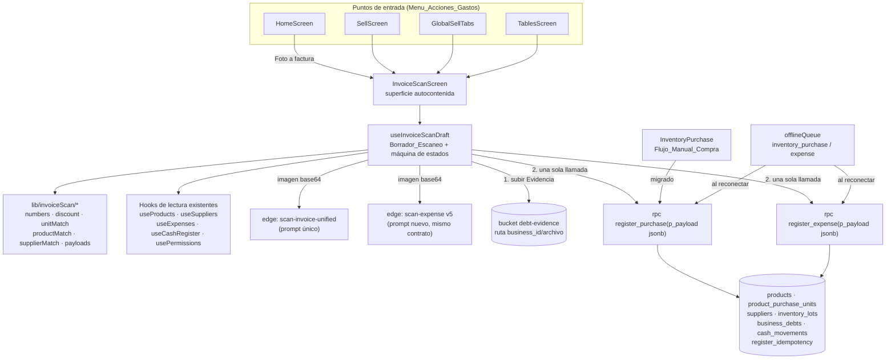
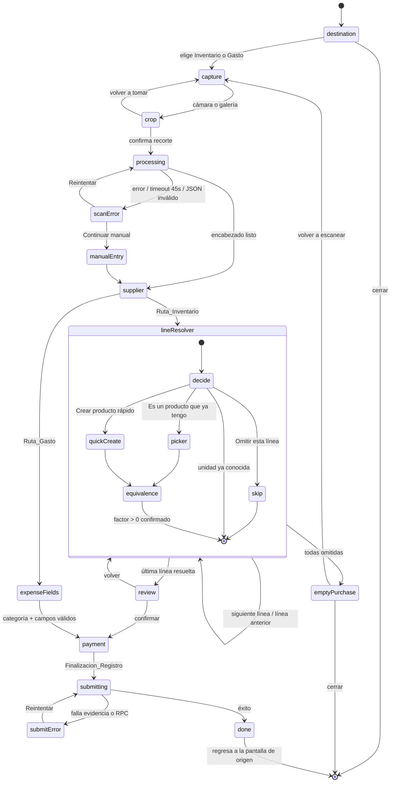
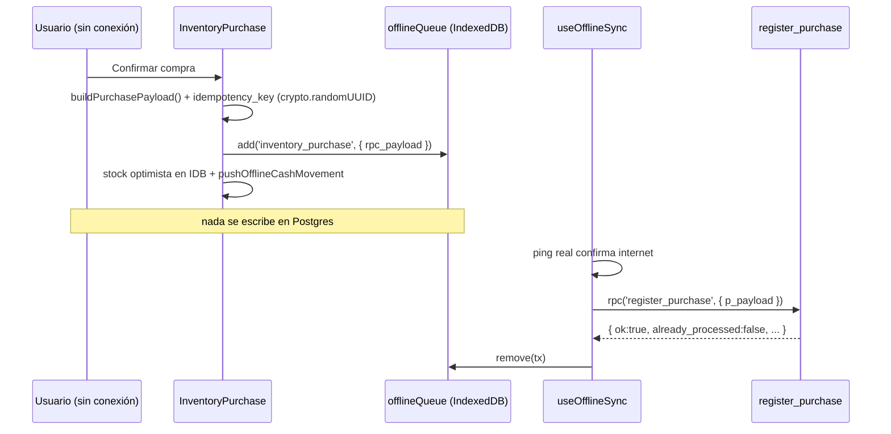

# Documento de Diseño: Escaneo de Factura Unificado

## Overview

El Escaneo_Unificado se implementa como una **superficie propia y autocontenida** (`screens/InvoiceScanScreen.tsx`) gobernada por una máquina de estados lineal con retroceso, cuyo estado completo vive en un único hook propietario (`hooks/useInvoiceScanDraft.ts`). Ningún paso navega fuera ni abre los formularios existentes.

La persistencia se concentra en **dos funciones RPC transaccionales** de Postgres — `register_purchase` y `register_expense` — que reciben un único `jsonb` con todo el registro y lo aplican en una sola transacción. El frontend queda como capa de captura, decisión y presentación; las reglas de turno, caja, stock, lote, deuda y movimientos viven exclusivamente en esas funciones. El `Flujo_Manual_Compra` (`InventoryPurchase.tsx`) se migra a `register_purchase` sin cambiar su UI ni su comportamiento observable.

Se elimina la fórmula de costo por proveedor: un **prompt único** en una edge function nueva (`scan-invoice-unified`) devuelve por línea un `Costo_Neto_Linea` con impuestos incluidos y descuentos de línea aplicados, más el `Descuento_Global` a nivel de documento, que el frontend reparte proporcionalmente.

### Estado real verificado (MCP Supabase, proyecto `hjjmwipqquynjopkswvu`)

Todo lo que sigue se verificó contra la base de datos y las funciones desplegadas, **no** contra los archivos locales de `supabase/`.

**Tablas y columnas relevantes (existen y se usan tal cual):**

| Tabla | Columnas clave verificadas |
|---|---|
| `products` | `business_id`, `name`, `type`, `price`, `cost`, `stock` (numeric, nullable), `unit` (default `'Und'`), `is_for_sale`, `nicknames` (`text[]`, default `{}`), `category_id`, `purchase_unit`, `conversion_factor` (legado) |
| `product_purchase_units` | `product_id`, `unit_name`, `conversion_factor` (default 1). **Sin `business_id`** (el negocio se deriva por `product_id`) y **sin índice único** por `(product_id, unit_name)` |
| `suppliers` | `business_id`, `name`, `nit`, `phone`, `address`, `color`, `invoice_config` (jsonb), `current_debt` |
| `inventory_lots` | `business_id`, `product_id`, `initial_quantity`, `remaining_quantity`, `unit_cost`, `purchase_date`, `supplier_name`, `product_name`, `notes` |
| `business_debts` | `business_id`, `type` (CHECK `supplier`/`other`), `creditor_name`, `description`, `total_amount`, `paid_amount`, `status` (CHECK `active`/`paid`/`overdue`), `due_date`, `supplier_id`, `inventory_lot_id`, `evidence_url` |
| `expenses` | `business_id`, `amount`, `description`, `category` (texto), `payment_method`, `receipt_url`, `expense_date` (default fecha en `America/Bogota`), `created_by` |
| `expense_categories` | `business_id`, `name`, `is_active` |
| `cash_movements` | `shift_id` (FK a `cash_shifts`, **no tiene `business_id`**), `created_by`, `type` (CHECK `opening`/`cash_in`/`cash_out`/`sale`/`expense`/`refund`/`purchase`), `amount`, `description`, `reference_id`, `reference_type`, `payment_method` |
| `cash_shifts` | `business_id`, `register_id`, `status`, `opening_balance`, totales por método |

**Hallazgo 1 — la tabla `debts` no existe.** El Requisito 11.6 menciona `debts`; la realidad verificada es que las deudas con proveedor viven en `business_debts` y las de clientes en `clients`/`client_transactions`. El diseño escribe únicamente en `business_debts`.

**Hallazgo 2 — `cash_movements.reference_type` rechaza `'purchase'`.** El CHECK vigente permite solo `('order','expense','sale_refund',NULL)`, pero `useCashRegister.recordPurchase` inserta `reference_type: 'purchase'` cuando recibe un `lotId`. Ese INSERT falla, el error se captura y se descarta, y el movimiento de caja de la compra **se pierde**. Consistente con el dato: en la base no existe ni un solo `cash_movements` de tipo `purchase` (hay 2302 `sale`, 109 `opening`, 8 `refund`, 1 `expense`). El diseño incluye una migración que extiende el CHECK para admitir `'purchase'`; sin ella el motor no podría dejar trazable la reversa por `reference_id`. `cash_movements` no está en la lista de tablas congeladas del Requisito 15.5.

**RLS vigente (todas las tablas con RLS activa):**

| Tabla | Lectura | Escritura |
|---|---|---|
| `products` | `business_id = get_user_business_id()` | **`... AND is_admin()`** |
| `product_purchase_units` | `EXISTS(products p JOIN profiles pr ...)` (ALL) | igual |
| `suppliers` | por negocio (via `profiles`) | por negocio |
| `inventory_lots` | por negocio (ALL) | por negocio |
| `business_debts` | por negocio | por negocio |
| `expenses` | por negocio | admin (ALL) **o** `Administrador`/`Cajero` (INSERT) |
| `expense_categories` | por negocio | admin (ALL) **o** `Administrador`/`Cajero` (INSERT) |
| `cash_movements` | `shift_id IN (cash_shifts del negocio)` (ALL) | igual |

**Edge functions desplegadas:** `scan-invoice` v30 (prompt con `invoiceConfig`, `verify_jwt=false`, Gemini 2.5 Flash, reintentos con backoff), `scan-expense` **v5** (prompt de descripción con dos familias de reglas generales en vez de una lista cerrada de tipos, con reglas duras que impiden un genérico "Otro"; `verify_jwt=false`; mismo contrato de cinco campos: `amount`, `description`, `supplierName`, `nit`, `date`), `generate-cost-formula` v20.

**Categorías de gasto por defecto (implementado, migraciones `20260804214205_seed_default_expense_categories_and_trigger` y `20260804214246_fix_mercancia_typo_expense_categories`).** Cada negocio se siembra con 11 categorías por defecto (`ARRIENDO`, `BIENES`, `HONORARIOS`, `IMPUESTOS`, `INSUMOS`, `MANTENIMIENTO`, `MERCANCÍA`, `PUBLICIDAD`, `SALUD Y PARAFISCALES`, `SERVICIOS`, `SUELDOS`): backfill idempotente (`ON CONFLICT (business_id, name) DO NOTHING`) para los existentes y el trigger `after_business_insert_seed_expense_categories` (`SECURITY DEFINER`, `search_path=public`, mismo patrón que `tg_new_business_seed_comanda_labels_visibility`) para los nuevos. La tabla `expense_categories` tiene `UNIQUE (business_id, name)`, que sostiene la idempotencia. El selector de categoría de la Ruta_Gasto (Req 11.3, 17.5) queda así siempre poblado.

**Funciones de apoyo existentes:** `get_user_business_id()`, `get_my_business_id()`, `current_user_has_permission(text)`, `is_admin()`, `get_active_shift()`, `calculate_expected_cash(uuid)`, `increment_stock(uuid,numeric)`. Todas `SECURITY DEFINER`.

**Precedente de seguridad del proyecto:** las migraciones `20260728044831 harden_mutating_rpcs_ownership_check` y `20260728045346 revoke_public_anon_on_mutating_rpcs` fijaron el patrón: RPC mutante = `SECURITY DEFINER` + `SET search_path = public` + chequeo explícito de pertenencia con `get_user_business_id()` + `REVOKE EXECUTE ... FROM PUBLIC, anon`. Los motores nuevos siguen ese mismo patrón.

---

## Architecture

### Vista general



### Principio de separación

| Capa | Responsabilidad | Qué NO hace |
|---|---|---|
| Edge function | Transcribir el documento a JSON (copiador fiel) | No convierte unidades, no reparte el descuento global, no toca la BD |
| `lib/invoiceScan/*` (puro) | Normalizar números, repartir descuento, comparar unidades, emparejar producto y proveedor, armar el payload | No hace fetch, no usa React |
| `useInvoiceScanDraft` | Dueño del Borrador_Escaneo, máquina de estados, orquestación de red | No calcula reglas de negocio de caja/stock |
| RPC (`register_*`) | Validar pertenencia y permisos, aplicar TODAS las escrituras en una transacción | No decide UX ni formatos de presentación |

### Máquina de estados



Reglas transversales de la máquina:

- **Retroceso**: cada paso declara `canGoBack` y su paso previo. En `lineResolver` el retroceso vuelve a la línea anterior y reabre su decisión (Req 6.8).
- **Salida con decisiones tomadas**: cualquier intento de cerrar cuando `draft.isDirty` pasa por `ConfirmDialog` y, al confirmar, descarta el borrador completo (Req 12.5).
- **Sin persistencia entre sesiones**: el borrador vive en memoria (`useRef` + `useState`), nunca en IndexedDB ni localStorage (Req 12.1, 12.6).

### T1 — RLS frente a la función RPC transaccional

**Decisión: `SECURITY DEFINER` con `SET search_path = public` y derivación del negocio desde la sesión.** No se usa `SECURITY INVOKER`.

**Por qué `SECURITY INVOKER` no es viable (dato, no suposición):** la política de escritura de `products` es `business_id = get_user_business_id() AND is_admin()`. Un usuario `Cajero` con `inv_purchase` **no puede** hacer `INSERT`/`UPDATE` en `products` con sus propios privilegios. Hoy ese usuario sí registra compras porque el stock se mueve por `increment_stock`, que es `SECURITY DEFINER`. Una función `INVOKER` rompería a todos los no-administradores con permiso de compra: sería una regresión frente al comportamiento vigente y contra el Requisito 14.3 (un solo conjunto de acciones para todo usuario con `inv_purchase`).

**Cómo se honra el Requisito 17.13 con `SECURITY DEFINER`:**

1. **La RLS permanece activa y sin debilitar** en las ocho tablas. Ninguna política se elimina, se relaja ni se reemplaza. Todas las lecturas del cliente (proveedores, productos, apodos, unidades de compra, categorías, saldos) siguen pasando por RLS con el JWT del usuario.
2. **El motor reproduce el mismo predicado que la política**: el negocio se deriva una única vez con `v_business := public.get_user_business_id()` y ese valor es el que se escribe en cada fila y el que filtra cada `WHERE`. El efecto sobre las filas es idéntico al que produciría la política.
3. **Se valida el permiso** con `public.current_user_has_permission('inv_purchase')` antes de escribir (Req 14.2/14.3).
4. **`search_path` fijo** a `public` para evitar secuestro de resolución de nombres.
5. **`REVOKE EXECUTE ... FROM PUBLIC, anon` y `GRANT EXECUTE ... TO authenticated, service_role`**, igual que las RPC endurecidas en `20260728045346`.

**Verificación de que no existe ruta de fuga entre negocios** (se prueba explícitamente, ver Testing Strategy):

| Vector | Guarda en el motor |
|---|---|
| `p_payload->>'business_id'` de otro negocio | Se compara contra `v_business`; si difiere → error `business_mismatch`, cero escrituras (Req 17.10/17.11) |
| Sesión sin negocio (`v_business IS NULL`) | Error `no_business` |
| `product.id` de otro negocio | `SELECT ... WHERE id = ... AND business_id = v_business` → si no hay fila, error `product_not_found` |
| `supplier.id` de otro negocio | mismo patrón → `supplier_not_found` |
| `shift_id` de otro negocio o cerrado | `SELECT ... FROM cash_shifts WHERE id = ... AND business_id = v_business AND status = 'open'` → `shift_invalid` |
| `product_purchase_units` (tabla sin `business_id`) | Solo se escribe con un `product_id` ya validado contra `v_business` |
| `cash_movements` (tabla sin `business_id`) | Solo se escribe con un `shift_id` ya validado contra `v_business` |
| Categoría de gasto ajena | Se resuelve por `(business_id = v_business, name)`; si no existe, se crea con `v_business` |
| Evidencia | La ruta del bucket es `${business_id}/${archivo}`, ya implementada en `useImageUpload` (Req 17.12) |

Ninguna consulta del motor omite el filtro por `v_business`, y `v_business` nunca proviene del payload. Esa es la propiedad que se verifica en pruebas (Property 2).

### T2 — Offline frente a transacción única

El escaneo con IA exige internet (Req 13.1/13.2): la opción "Foto a factura" se muestra deshabilitada en `Modo_Sin_Conexion` y explica por qué, ofreciendo "Compra de inventario" y "Otros gastos" como salida manual. Lo que debe convivir con la transacción única es el **registro manual**, que sí tiene soporte offline vigente.

**Encolado de la intención, no de los pasos.** Hoy `syncInventoryPurchase` reimplementa la compra completa desde el cliente (lee stock, llama `increment_stock`, inserta lote, inserta deuda, inserta movimientos). Tras la migración, la cola guarda **el payload de la RPC ya armado** y el sincronizador hace una sola llamada:



**Idempotencia del reintento.** El payload lleva un `idempotency_key` (UUID v4 generado en el cliente **al encolar**, no al sincronizar; así el reintento reusa la misma clave). El motor arranca con:

```sql
INSERT INTO public.register_idempotency (key, business_id, operation)
VALUES (v_key, v_business, 'purchase');
-- si viola la PK: la operación ya se aplicó
EXCEPTION WHEN unique_violation THEN
  SELECT result INTO v_prev FROM public.register_idempotency
   WHERE key = v_key AND business_id = v_business;
  RETURN v_prev || jsonb_build_object('already_processed', true);
```

Como el `INSERT` de la clave vive **dentro de la misma transacción** que el resto de las escrituras, un fallo posterior revierte también la clave: el reintento vuelve a intentar desde cero (Req 12.9) y no queda una clave "quemada" sin registro. Si la transacción sí llegó a hacer `COMMIT` y lo que se perdió fue la respuesta HTTP (el escenario clásico de duplicado), el reintento choca con la PK y devuelve el resultado original sin duplicar la compra.

Tabla nueva `register_idempotency` (`key uuid PK`, `business_id uuid`, `operation text`, `result jsonb`, `created_at timestamptz`), con RLS `business_id = get_user_business_id()` y purga por antigüedad (> 30 días) en el mismo `cron`/limpieza ya existente. No es una tabla compartida entre negocios (Req 15.7): cada fila pertenece a un negocio y la política lo restringe.

**Evidencia sin red.** La subida al bucket es imposible offline. El diseño **conserva el comportamiento vigente**: el registro manual offline se encola con `evidence_url = null` (que es exactamente lo que hace hoy `InventoryPurchase`, donde `evidenceUpload.imageUrl` está vacío sin red) y la UI avisa: *"Sin conexión: la compra se guardará sin la foto de la factura."* Si la conexión se cae con un Borrador_Escaneo en curso (Req 13.4), se aplica la misma regla: se permite finalizar por el camino offline y se informa que la imagen capturada no quedará adjunta. Guardar el blob en IndexedDB para subirlo al reconectar queda registrado como mejora futura, fuera del alcance de esta iteración: agrega un store nuevo y un modo de fallo (subida fallida tras el registro) que hoy no existe.

**Cómo se mantiene el Requisito 16.9 tras la migración.** La UI, las validaciones y los mensajes de `InventoryPurchase` no se tocan; lo único que cambia es el bloque final de `handleSave`, que pasa de N escrituras sueltas a `buildPurchasePayload()` + una llamada RPC. La paridad se verifica con: (a) pruebas unitarias del constructor de payload sobre estados de UI congelados; (b) una prueba de *golden master* que compara, en una rama de base de datos, las filas resultantes de la ruta legado y de la RPC para la misma compra (normalizando ids y timestamps); (c) la Property 5, que exige el mismo resultado para el mismo payload sin importar el `source`.

---

## Components and Interfaces

### Archivos nuevos

```
screens/
  InvoiceScanScreen.tsx            Host del flujo. Renderiza el paso activo. Sin lógica de negocio.

hooks/
  useInvoiceScanDraft.ts           Dueño del Borrador_Escaneo, máquina de estados y llamadas de red.

lib/invoiceScan/
  types.ts                         Tipos del borrador y de los payloads RPC.
  numbers.ts                       parseLatinNumber, toPesos (redondeo a entero), splitProportional.
  discount.ts                      distributeGlobalDiscount (resto mayor).
  unitMatch.ts                     normalizeUnit (Comparacion_Unidad), detectUnitCase.
  productMatch.ts                  matchProductLine (cascada de 4 pasos).
  supplierMatch.ts                 matchSupplierHeader (NIT → nombre). Reusa norm/normNit.
  buildPurchasePayload.ts          Borrador → payload de register_purchase.
  buildExpensePayload.ts           Borrador → payload de register_expense.

components/invoiceScan/
  ScanStepShell.tsx                Chrome común: título, progreso, atrás, cerrar, aria-live.
  ScanDestinationStep.tsx          Selector_Destino (2 opciones + cerrar).
  ScanCaptureStep.tsx              Cámara / galería + límite 50 MB. Reusa InAppCamera fullFrame.
  ScanCropStep.tsx                 Recorte de esquinas. Reusa DocumentCropper.
  ScanProcessingStep.tsx           Indicador de progreso con texto del paso.
  ScanErrorStep.tsx                Reintentar / Continuar manual.
  ScanSupplierStep.tsx             Resolutor_Proveedor (confirmado / nuevo / buscar existente).
  ScanLineResolverStep.tsx         Una Linea_Factura a la vez + progreso "i de n".
  ScanQuickProductForm.tsx         Creacion_Rapida_Producto (paso interno).
  ScanProductPickerSheet.tsx       Buscador por nombre y Apodo (solo type='simple').
  ScanUnitEquivalenceForm.tsx      Pregunta de Factor_Conversion + previsualización.
  ScanReviewStep.tsx               Panel_Revision editable.
  ScanPaymentStep.tsx              Contado/Crédito, descuento de caja, métodos, abono, vencimiento.
  ScanExpenseFieldsStep.tsx        Campos del gasto + CategoryPickerSheet.
```

### Reutilización (sin duplicar lógica de negocio)

| Se reutiliza | De dónde | Para qué |
|---|---|---|
| `InAppCamera` (`fullFrame`), `DocumentCropper` | `components/` | Captura y recorte, idéntico al escaneo de gasto vigente |
| `compressImage`, `blobToBase64` | `lib/imageUtils.ts` | Compresión a 1600 px antes de la edge function |
| `useImageUpload(null,'debt-evidence')` | `hooks/` | Subida de Evidencia a `business_id/archivo` |
| `CategoryPickerSheet`, `ObservationSheet` | `components/expense/` | Categoría y observación del gasto |
| `norm`, `normNit`, `normalizeLatinAmount`, `resolveAmountField`, `truncateDescription`, `matchSupplier`, `resolveExpenseDate` | `components/expense/scanExpense.logic.ts` | Ruta_Gasto con las mismas reglas de hoy (Req 11.2) |
| `useProducts`, `useSuppliers`, `useExpenses`, `useCashRegister`, `usePermissions` | `hooks/` | Lecturas por negocio, categorías, turno y saldos, permiso |
| `isRealOffline`, `offlineQueue`, `pushOfflineCashMovement` | `lib/` | Detección real de red y camino offline |
| `formatCurrency`, `formatWithThousands`, `parseCleanNumber` | `lib/formatters.ts`, `components/expense/shared.ts` | Formato de moneda consistente |

### Interfaz del hook propietario

```ts
// hooks/useInvoiceScanDraft.ts
export type ScanStep =
  | 'destination' | 'capture' | 'crop' | 'processing' | 'scanError' | 'manualEntry'
  | 'supplier' | 'lineResolver' | 'emptyPurchase' | 'review'
  | 'expenseFields' | 'payment' | 'submitting' | 'submitError' | 'done';

export interface UseInvoiceScanDraft {
  step: ScanStep;
  draft: ScanDraft;                       // Borrador_Escaneo (solo memoria)
  progress: { current: number; total: number } | null;
  isDirty: boolean;
  canGoBack: boolean;

  chooseDestination: (d: 'inventory' | 'expense') => void;
  attachImage: (file: File) => Promise<void>;          // valida 50 MB
  confirmCrop: (blob: Blob) => Promise<void>;          // comprime, guarda Evidencia, escanea
  retryScan: () => Promise<void>;
  continueManual: () => void;

  confirmSupplier: (s: SupplierDecision) => void;
  resolveLine: (d: LineDecision) => void;              // link | create | skip
  setLineEquivalence: (factor: number) => void;
  goToPreviousLine: () => void;

  updateReviewLine: (i: number, patch: ReviewPatch) => void;
  removeReviewLine: (i: number) => void;

  setPayment: (p: PaymentDraft) => void;
  finalize: () => Promise<FinalizeResult>;             // sube Evidencia + 1 RPC
  requestClose: () => void;                            // confirma si isDirty
}
```

### Edge function `scan-invoice-unified`

Se crea **nueva** en lugar de modificar `scan-invoice` v30, porque el escaneo embebido en `InventoryPurchase` debe conservar su comportamiento durante esta iteración (Req 15.1) y hoy depende del prompt con `invoiceConfig`.

Contrato:

```
POST /functions/v1/scan-invoice-unified
body: { imageBase64: string, mimeType: string }
```

El body **no** incluye datos del catálogo ni del proveedor: el prompt es único para todos los proveedores (Req 3.1, 4.4) y así no viaja información del negocio más allá de la imagen (Req 17.6).

Respuesta (JSON Schema obligatorio en `generationConfig.responseSchema`, `temperature: 0.1`, modelo `gemini-2.5-flash`, reintentos con backoff para 429/503/502 igual que `scan-invoice`):

```jsonc
{
  "header": {
    "supplierName": "DISTRIBUIDORA X SAS" | null,
    "nit": "900123456-7" | null,
    "invoiceNumber": "F-00123" | null,
    "date": "2026-08-01" | null
  },
  "document": {
    "globalDiscount": 5000,      // descuento al pie, 0 si no hay
    "documentTotal": 240000      // informativo, para conciliación visual
  },
  "items": [
    {
      "description": "BONYURT CHOCOKRISPIS CJ X 6",
      "quantity": 2,             // cantidad facturada (col. cantidad), no "und. emp."
      "ocr_unit": "CJ",          // empaque deducido de la descripción; "" si es unidad suelta. NUNCA el código DIAN "94"
      "unitValue": 12000,
      "lineSubtotal": 24000,
      "lineTax": 4560,           // impuestos DE ESA línea
      "lineDiscount": 2000,      // descuentos DE ESA línea
      "lineNetTotal": 26560      // subtotal + impuestos − descuentos de línea
    }
  ]
}
```

Instrucciones clave del prompt único:

1. **Rol de copiador fiel.** Transcribe; no convierte unidades ni interpreta empaques (eso lo hace el frontend).
2. **Impuestos y descuentos de línea.** Si la factura los presenta por renglón (IVA, impuesto al consumo, descuento comercial), devuélvelos en `lineTax` y `lineDiscount` y entrega `lineNetTotal = lineSubtotal + lineTax − lineDiscount` (Req 3.2). Si la factura ya trae el total de línea con impuestos incluidos, `lineTax = 0` y `lineNetTotal` = ese total. **Nunca** cuentes dos veces un impuesto que ya está dentro del valor unitario.
3. **Descuento global.** Un descuento al pie que aplica al total del documento va en `document.globalDiscount` y **no** se resta de ninguna línea (Req 3.4).
4. **Formato numérico latino.** Punto = miles, coma = decimales; devuelve siempre números con punto decimal (Req 3.3). Ejemplos en el prompt: `8.100 → 8100`, `0,44 → 0.44`, `1.980 → 1980`.
5. **Unitario derivado.** Si falta el valor unitario pero hay total y cantidad, `unitValue = total / quantity` (Req 3.6).
6. **Todas las líneas.** Sin omitir renglones; excluye únicamente filas que no son producto (fletes, totales, retenciones), que no deben aparecer como ítems.
7. **`ocr_unit` se deduce de la descripción, no de la columna de unidad.** En Colombia la columna de unidad de medida casi siempre trae el **código fiscal DIAN `94`** (o `UND`), que significa "Unidad" y **no** identifica el empaque de compra: en una misma factura conviven `SAL*1KG` y `.ARROBA ARROZ*25*500G` ambos con U/M `94`. Por eso el prompt debe **ignorar `94`/`UND` como unidad** y extraer `ocr_unit` del **texto de la descripción**, reconociendo (a) palabras de empaque —`CAJA`/`CJ`, `BULTO`, `PACA`, `ARROBA`, `DOCENA`, `MEDIA DOCENA`, `TIRA`, `BLISTER`, `SIXPACK`, `DISPLAY`, `PAQUETE`— y (b) multiplicadores de conteo —`X 3 UN`, `12X4`, `X6`, `*25*`, `PACA X N`—. Devuelve `ocr_unit = ""` solo cuando la línea es una unidad suelta sin empaque ni multiplicador (Req 3.13, 9.15/9.18). El texto se copia tal como se lee, sin convertir (la conversión la hace el frontend).
8. **Cantidad correcta cuando hay varias columnas.** Los distribuidores grandes (por ejemplo Zenú, Bimbo) presentan a la vez columnas de **cantidad facturada** (`Cantidad`, `Cant`, `Cantidades sueltas`) y de **unidades por empaque** (`Und. emp.`, `Presentación`). La `quantity` de la línea es la **cantidad facturada**; nunca las unidades por empaque ni el contenido por unidad (`500G`, `2000ML`), que describen el producto pero no cuánto se compró (Req 3.14).
9. **Sin datos → neutro.** Campos de texto ausentes en `null`, numéricos en `0`.

Degradación: si Gemini devuelve texto no parseable, la función responde `200` con `{ header:{}, document:{globalDiscount:0}, items:[], error:"..." }`, y el frontend lo trata como escaneo fallido (mismo patrón que `scan-invoice`).

### Algoritmo de coincidencia de proveedor

```
matchSupplierHeader(header, suppliers /* del Negocio_Activo */):
  1. nit = normNit(header.nit)            // quita espacios, puntos y guiones
     si nit ≠ "" y existe s con normNit(s.nit) = nit  → confirmado(s)      (5.1, 5.2)
  2. name = norm(header.supplierName)     // minúsculas, sin acentos, trim
     si name ≠ "" y existe s con norm(s.name) = name → confirmado(s)       (5.3)
  3. si name ≠ "" o nit ≠ ""              → nuevo({ name, nit }) editable  (5.4, 5.5)
  4. si ambos vacíos                      → requiereSeleccionManual         (5.7)
```
Sin proveedor confirmado el paso no avanza y `finalize` está bloqueado (Req 5.8). El proveedor nuevo se conserva en el borrador y se crea dentro de la transacción (Req 5.6, 12.2).

### Algoritmo de coincidencia de producto

```
matchProductLine(ocrName, products /* type='simple', del Negocio_Activo */):
  q = norm(ocrName)
  1. Apodo exacto:        products con algún nickname cuyo norm() = q      → único ⇒ match
  2. Apodo parcial:       nickname que contiene q (o q contiene nickname)  → único ⇒ match
  3. Nombre exacto:       norm(name) = q                                   → match
  4. Nombre parcial:      norm(name) contiene q                            → único ⇒ match
  sin resultado o resultado ambiguo (>1) ⇒ pendiente de decisión           (6.1, 6.6)
```
Un nivel con más de un candidato **no** resuelve: pasa al siguiente nivel y, si ninguno da resultado único, la línea queda pendiente. Los insumos (`is_for_sale = false`) son destinos válidos; los `processed` y `service` no (Req 8.7).

### Detección de unidad y `Comparacion_Unidad`

```
normalizeUnit(u):
  s = trim(lower(u)) sin acentos                    // NFD + strip diacríticos
  s = s sin espacios internos repetidos
  si s termina en "es" y length > 4 → quitar "es"   // "bultoes" no aplica; "meses"→"mes" no ocurre en unidades
  si s termina en "s"  y length > 3 → quitar "s"    // "cajas"→"caja", "bultos"→"bulto"
  retornar s
```
La regla de plurales es deliberadamente simple (solo `-s` y `-es` finales sobre cadenas de más de 3/4 caracteres) para no destruir abreviaturas cortas (`kg`, `cj`, `lbs`→`lb`, `und`). Se aplica **idéntica** en los tres casos (Req 9.5, 9.6).

```
detectUnitCase(ocrUnit, product):
  u = normalizeUnit(ocrUnit)
  si u = ""                                   → CASO_SIN_UNIDAD   (9.18) factor 1
  si u = normalizeUnit(product.unit)          → CASO_VENTA        (9.1)  factor 1
  si existe pu en product.product_purchase_units con normalizeUnit(pu.unit_name) = u
                                              → CASO_CONOCIDO     (9.2)  factor = pu.conversion_factor,
                                                 sin preguntar nada, sin crear fila (9.14)
  en otro caso                                → CASO_DESCONOCIDO  (9.3, 9.4) preguntar factor,
                                                 crear fila nueva en la Finalizacion (9.12, 9.13)
```

Conversión aplicada al confirmar el factor `f`:

```
quantity_venta = quantity_ocr × f
total_linea     = costo_neto_linea_por_unidad_ocr × quantity_ocr     (invariante)
costo_por_unidad_venta = total_linea / quantity_venta = costo_ocr / f
```

El borrador y el payload transportan **`quantity` (en Unidad_Venta) y `line_total` (entero en pesos)**; el costo unitario se deriva en el motor como `line_total / quantity`. Así el total de la línea se conserva exactamente y no hay deriva por redondeo de un unitario con decimales (Colombia opera en pesos sin centavos). El Panel_Revision muestra el unitario derivado con hasta 2 decimales, solo para lectura y edición.

### Reparto del `Descuento_Global`

```
distributeGlobalDiscount(D, netTotals[]):
  S = Σ netTotals
  si D ≤ 0 o S ≤ 0 → devolver ceros
  D = min(D, S)                                  // el descuento no puede superar el total
  exact_i  = D × net_i / S
  share_i  = floor(exact_i)
  r        = D − Σ share_i                        // residuo entero, 0 ≤ r < n
  ordenar índices por (frac(exact_i) desc, net_i desc, i asc)
  sumar 1 peso a los primeros r índices           // método del resto mayor
  devolver share[]
```
Garantías: `Σ share_i = D` exactamente, cada `share_i` es entero, `0 ≤ share_i ≤ net_i`. El costo neto de la línea pasa a `net_i − share_i` (Req 3.5). El desempate determinista (fracción, luego monto, luego índice) hace el reparto reproducible, condición necesaria para la paridad y para las pruebas.

El mismo helper (`splitProportional`) se usa para repartir el **abono inicial** entre líneas y el **monto de cada método de pago** entre líneas, reemplazando los `Math.round(x * share)` sueltos del flujo actual, que pueden dejar residuos de ±1 peso.

### Creacion_Rapida_Producto

Paso interno, sin navegar a `SimpleProductScreen` (Req 7.11). Campos: nombre (prellenado con `Nombre_OCR`), categoría (selector de `categories` del negocio), Unidad_Venta, costo (prellenado con el Costo_Neto_Linea por Unidad_Venta), precio de venta (opcional) y destino "Para venta" / "Insumo". Validación: nombre, categoría, unidad y costo > 0 (Req 7.3). Al elegir "Insumo": `is_for_sale = false`, `price = 0` (Req 7.5). Sin imagen, sin código de barras, sin apodos (Req 7.10). Stock inicial 0: la cantidad la aporta el lote de la compra (Req 7.6).

Aviso de nombre duplicado: si `norm(nombre)` coincide con un producto existente, se advierte y se ofrece vincular la línea a ese producto en lugar de crear uno nuevo (Req 7.9).

Se replican los valores que hoy escribe `SimpleProductScreen` para que el producto nuevo sea indistinguible de uno creado a mano: `type = 'simple'`, `is_active = true`, `description = 'Producto para venta' | 'Insumo'`, `nicknames = []`, `purchase_unit = null`, `conversion_factor = 1`.

### Apodos

Al vincular por "Es un producto que ya tengo", la propuesta de agregar el `Nombre_OCR` como Apodo viene activada (Req 8.3). Casos:

- Ya es Apodo del **mismo** producto → se informa y se omite la propuesta (Req 8.5).
- Ya es Apodo de **otro** producto del negocio → se informa en cuál está y la vinculación se mantiene **sin** agregar el apodo (Req 8.6).
- El motor agrega el apodo con `array_append` solo si no existe (comparación normalizada), de modo que un reintento no duplica entradas.

### Motores RPC

```sql
public.register_purchase(p_payload jsonb) RETURNS jsonb
public.register_expense(p_payload jsonb)  RETURNS jsonb
LANGUAGE plpgsql SECURITY DEFINER SET search_path = public
```

Un único parámetro `jsonb` mantiene estable la firma (agregar un campo no obliga a recrear la función ni rompe clientes viejos) y permite versionar el payload con `"v": 1`.

Respuesta de éxito:

```jsonc
{
  "ok": true,
  "already_processed": false,
  "supplier_id": "uuid",
  "created_product_ids": ["uuid"],
  "lot_ids": ["uuid"],
  "debt_ids": ["uuid"],
  "cash_movement_ids": ["uuid"],
  "expense_id": null,
  "totals": { "lines": 3, "amount": 240000 }
}
```

Respuesta de error (sin excepción, para que el cliente no reciba un 500 opaco): `{"ok": false, "code": "...", "message": "..."}`. La transacción se revierte con `RAISE`/rollback interno antes de construir la respuesta, de modo que un `ok:false` implica **cero escrituras** (Req 12.7).

#### `register_purchase` — orden de escrituras

```
 0. v_business := get_user_business_id();            si NULL → no_business
 1. si p_payload->>'business_id' ≠ v_business        → business_mismatch          (17.10)
 2. si NOT current_user_has_permission('inv_purchase') → forbidden                (14.2)
 3. validar payload: v = 1, ≥1 línea, quantity > 0, line_total ≥ 0,
    conversion_factor > 0, is_credit ⇒ due_date NOT NULL, Σ métodos ≤ Σ line_total
 4. idempotencia: INSERT en register_idempotency (unique_violation ⇒ devolver resultado previo)
 5. proveedor: id existente validado por negocio, o INSERT nuevo con business_id = v_business
 6. turno: si deduct_from_cash ⇒ shift_id abierto y del negocio; validar saldo en efectivo
    con la misma fórmula de calculate_expected_cash ⇒ insufficient_cash_balance
 7. por cada línea, en orden del payload:
    7.1 producto: id validado por negocio, o INSERT nuevo (stock 0, price/cost del formulario)
    7.2 apodo: array_append si add_nickname y el apodo normalizado no existe             (8.4)
    7.3 unidad de compra: INSERT en product_purchase_units solo si no existe una
        con normalizeUnit(unit_name) igual; nunca UPDATE de las existentes         (9.12, 9.13, 9.14)
    7.4 precio de venta: UPDATE products.price si new_price no es NULL                  (10.4)
    7.5 lote: leer stock_before con SELECT ... FOR UPDATE del producto;
        INSERT inventory_lots(initial_quantity = quantity,
                              remaining_quantity = max(0, quantity + least(0, stock_before)),
                              unit_cost = line_total / quantity,
                              purchase_date, supplier_name, product_name)
    7.6 stock: UPDATE products SET stock = greatest(0, coalesce(stock,0) + quantity)
    7.7 deuda: INSERT business_debts (type='supplier', creditor_name, supplier_id,
        inventory_lot_id, evidence_url, description con el mismo formato del flujo manual,
        total_amount = line_total,
        paid_amount = crédito ? reparto del abono : line_total,
        status = paid_amount ≥ total_amount ? 'paid' : 'active')
 8. abono inicial (solo crédito y paid_amount > 0): INSERT business_debts
    (total_amount = 0, paid_amount = abono, status='paid', description='Abono: Pago al momento de compra')
 9. movimientos de caja (solo contado + deduct_from_cash + turno abierto):
    INSERT cash_movements por (línea × método) con reparto proporcional y ajuste del residuo,
    type='purchase', payment_method = mapped_id, reference_id = lot_id, reference_type='purchase'
    En crédito con abono: un movimiento por el abono con el método elegido.
10. registrar resultado en register_idempotency.result y devolver ok:true
```

El bloqueo `SELECT ... FOR UPDATE` sobre el producto (7.5) serializa dos compras concurrentes del mismo producto, lo que hoy se mitiga a medias con `increment_stock`. Como todo ocurre en una transacción, el lote y el stock quedan siempre consistentes.

#### `register_expense` — orden de escrituras

```
 0-4. idénticos (permiso: inv_purchase; validaciones: amount > 0, category no vacía,
      expense_date ≤ hoy en America/Bogota, is_credit ⇒ due_date, Σ métodos ≤ amount)
 5. proveedor: existente validado o nuevo
 6. categoría: SELECT por (business_id, upper(name)); si no existe, INSERT con v_business   (17.5)
 7. INSERT expenses (business_id, amount, description, category, payment_method,
    receipt_url, expense_date, created_by = auth.uid())
 8. business_debts:
    crédito  → total_amount = amount, paid_amount = abono, status según cobertura, due_date
    contado  → fila de trazabilidad (total = paid = amount, status 'paid') con la misma evidence_url
 9. cash_movements (type='expense', reference_id = expenses.id, reference_type='expense')
    tanto para contado con descuento de caja como para el abono inicial en crédito
10. resultado + ok:true
```

#### Errores devueltos al cliente

| `code` | Cuándo | Mensaje al usuario |
|---|---|---|
| `no_business` | Sesión sin negocio | "Tu sesión no tiene un negocio asignado." |
| `business_mismatch` | `business_id` del payload ≠ sesión | "No autorizado para esta operación." |
| `forbidden` | Sin `inv_purchase` | "No tienes permiso para registrar compras y gastos." |
| `invalid_payload` | Estructura o valores inválidos | "Los datos del registro están incompletos." |
| `supplier_not_found` | Proveedor de otro negocio o inexistente | "El proveedor ya no existe." |
| `product_not_found` | Producto de otro negocio o inexistente | "Un producto de la factura ya no existe en tu catálogo." |
| `shift_invalid` | Turno cerrado o de otro negocio | "El turno de caja ya no está abierto." |
| `insufficient_cash_balance` | Efectivo del turno insuficiente | "Saldo insuficiente en efectivo. Disponible: $X." |
| `overpayment` | Σ métodos > total | "La suma de los pagos supera el total." |

### Migración del `Flujo_Manual_Compra`

Cambio quirúrgico en `InventoryPurchase.handleSave`:

| Antes | Después |
|---|---|
| Camino online: bucle con `updateProductStock` + `createDebt` + `recordPurchase` por ítem y método | `buildPurchasePayload({ source:'manual', ... })` + `supabase.rpc('register_purchase', { p_payload })` |
| Camino offline: `offlineQueue.add('inventory_purchase', payload propio)` | `offlineQueue.add('inventory_purchase', { rpc_payload })` con `idempotency_key` |
| `syncInventoryPurchase`: reimplementa la compra (lee stock, `increment_stock`, lote, deuda, movimientos) | una sola llamada `rpc('register_purchase', { p_payload })` |
| `onSave({type:'inventory'...})` para el egreso | se conserva igual (hoy `HomeScreen` ignora `type === 'inventory'`, así que no crea nada) |

No se toca: pestañas, historial, edición y eliminación de compras, escáner de barras, escaneo embebido, selector de proveedor, validaciones de saldo del frontend (se mantienen como pre-chequeo de UX), stock optimista en IndexedDB ni `pushOfflineCashMovement`.

Estrategia de verificación de paridad:

1. **Payload congelado**: pruebas unitarias que fijan estados de UI representativos (1 ítem contado con caja; 3 ítems crédito con abono; pago dividido en 2 métodos; sin turno activo) y comparan el payload generado contra un snapshot.
2. **Golden master en rama de BD**: en una rama de desarrollo, ejecutar la misma compra por la ruta legado y por la RPC y comparar `inventory_lots`, `products.stock`, `business_debts` y `cash_movements` normalizando `id`, `created_at` y `purchase_date`. Diferencias esperadas y aceptadas: el movimiento de caja de la compra ahora **sí** se inserta (Hallazgo 2) y los residuos de reparto de ±1 peso desaparecen.
3. **Property 5** (paridad escaneo/manual) y **Property 6** (idempotencia).

### Código que se elimina

| Elemento | Acción | Nota |
|---|---|---|
| `components/expense/CostFormulaBuilder.tsx` | eliminar | Sin otros consumidores |
| `components/expense/InvoiceConfigPanel.tsx` | eliminar | Junto con su botón y estado en `InventoryPurchase` |
| `evaluateCostFormula` en `InvoiceReviewPanel.tsx` | eliminar | El total de línea pasa a ser `quantity × unitCost`, que ya es el valor de retorno cuando no hay fórmula |
| `useSuppliers.updateSupplierInvoiceConfig`, tipos `InvoiceConfig`/`InvoiceField`, `DEFAULT_INVOICE_CONFIG` | eliminar tras quitar sus usos | `scan-invoice` v30 ya aplica su config por defecto cuando el body no la trae |
| edge function `generate-cost-formula` | eliminar del proyecto tras confirmar cero referencias | Es un consumidor de `GEMINI_API_KEY` sin uso: menos superficie |

`suppliers.invoice_config` **no se borra ni se modifica**: las filas conservan sus datos y el sistema los ignora (Req 4.3).

> **Desviación documentada del Requisito 15.1.** Quitar `evaluateCostFormula` y el `Panel_Reglas_Factura` cambia un detalle del escaneo embebido de `InventoryPurchase`: para los proveedores que hoy tienen `costFormula` configurada, el total de línea pasará a calcularse como `cantidad × valor unitario` en lugar de evaluarse con la fórmula. Es el precio de eliminar la fórmula, que es el objetivo central de la funcionalidad (Introducción, cambio *b*); mantener la fórmula viva solo para el flujo embebido conservaría exactamente el código que se busca borrar, incluida la evaluación con `new Function()` marcada como riesgo de seguridad en `flujo_compra_inventario.md`. El resto del escaneo embebido (prompt, emparejamiento, panel de revisión, conversión de unidades) queda intacto.

### Puntos de entrada del menú

`HomeScreen` (hoja inferior), `SellScreen`, `GlobalSellTabs` y `TablesScreen` construyen hoy su lista con el arreglo literal `['Compra de inventario','Otros gastos','Merma']`. Para no repetir la lógica cuatro veces se extrae un componente compartido `components/expense/ExpenseActionsMenu.tsx` que recibe `variant: 'sheet' | 'dropdown'` y expone las cuatro opciones con "Foto a factura" primero (Req 1.1), su estado deshabilitado offline con el aviso correspondiente (Req 13.1/13.2) y el filtro por `hasPermission('inv_purchase')` (Req 14.1). Las tres opciones existentes conservan su comportamiento (Req 1.6).

### Accesibilidad y diseño de onboarding

- `ScanStepShell` provee: título del paso, contador "Paso i de n" / "Línea i de n", botón atrás (`aria-label="Volver al paso anterior"`), botón cerrar (`aria-label="Cerrar el escaneo"`) y una región `aria-live="polite"` donde se anuncian los cambios de paso y los resultados de conversión.
- Todo elemento interactivo no nativo lleva `role="button"`, `tabIndex={0}`, `aria-label` descriptivo y `onKeyDown` (Enter y Espacio) además de `onClick`.
- Foco: al entrar a un paso, el foco se mueve al encabezado del paso; en los pasos con un solo campo (factor de conversión, valor del gasto) al campo.
- El control para continuar permanece `disabled` con `aria-disabled` mientras el paso no valida (por ejemplo factor ≤ 0, Req 9.8).
- Paleta Warm Bistro con Tailwind: acción primaria `bg-amber-400 hover:bg-amber-500 text-slate-900`, superficies `bg-slate-50`, encabezados y chips de confirmación en `emerald` (`#102218` para texto sobre claro), errores en `rose-600`. Sin CSS plano ni `<style>`.
- Objetivos táctiles mínimos de 44 px y una sola decisión por pantalla, que es lo que sostiene el patrón de onboarding (Req 6.3, 6.5).

---

## Data Models

### Borrador_Escaneo (solo memoria)

```ts
// lib/invoiceScan/types.ts
export type ScanDestination = 'inventory' | 'expense';

export interface ScanDraft {
  destination: ScanDestination | null;
  image: { blob: Blob; previewUrl: string } | null;   // Evidencia + entrada de la IA
  evidenceUrl: string | null;                         // se llena en la Finalizacion
  idempotencyKey: string;                             // crypto.randomUUID(), al abrir el flujo

  header: {
    supplierName: string | null;
    nit: string | null;
    invoiceNumber: string | null;
    date: string | null;                              // "YYYY-MM-DD"
  };
  globalDiscount: number;                             // pesos, ya normalizado

  supplier:
    | { kind: 'existing'; id: string; name: string }
    | { kind: 'new'; name: string; nit: string }
    | null;

  lines: ScanLine[];
  currentLineIndex: number;

  expense: {                                          // solo Ruta_Gasto
    amount: string; description: string;
    category: string | null; date: string;
  } | null;

  payment: PaymentDraft;
}

export interface ScanLine {
  id: string;                        // local
  ocrName: string;
  ocrUnit: string;                   // texto tal como lo devolvió la IA (9.15)
  ocrQuantity: number;
  netTotal: number;                  // Costo_Neto_Linea de la IA (impuestos incluidos)
  globalDiscountShare: number;       // parte proporcional asignada (3.5)
  needsReview: boolean;              // cantidad ilegible ⇒ true, cantidad = 1 (3.12)

  decision:
    | { kind: 'pending' }
    | { kind: 'linked'; productId: string; addNickname: boolean }
    | { kind: 'created'; newProduct: NewProductDraft }
    | { kind: 'skipped' };

  unitCase: 'sale' | 'known' | 'unknown' | 'none' | null;
  conversionFactor: number | null;   // 1 en sale/none; guardado en known; pedido en unknown
  createPurchaseUnit: boolean;       // true solo en unknown (9.12)

  quantity: number | null;           // en Unidad_Venta, tras conversión
  lineTotal: number | null;          // pesos, netTotal − globalDiscountShare
  newPrice: number | null;           // precio de venta editado en el Panel_Revision
}

export interface NewProductDraft {
  name: string; categoryId: string; unit: string;
  cost: number; price: number; isForSale: boolean;
}

export interface PaymentDraft {
  isCredit: boolean;
  dueDate: string | null;
  paidAmount: number;                // abono inicial en crédito
  deductFromCash: boolean | null;    // null = no respondió (con turno activo bloquea)
  shiftId: string | null;
  methods: { methodId: string; mappedId: string; amount: number }[];
  creditInitialMethodId: string | null;
}
```

### Payload de `register_purchase`

```jsonc
{
  "v": 1,
  "idempotency_key": "8f14e45f-ea3b-4b1d-9c2e-1a2b3c4d5e6f",
  "business_id": "uuid",                      // solo para la validación 17.10
  "source": "scan",                           // "scan" | "manual"
  "purchase_date": "2026-08-01T12:00:00.000Z",
  "evidence_url": "https://.../debt-evidence/<business_id>/f.webp",
  "invoice_number": "F-00123",
  "supplier": { "id": "uuid" },               // o { "new": { "name": "...", "nit": "..." } }
  "payment": {
    "is_credit": false,
    "due_date": null,
    "paid_amount": 0,
    "deduct_from_cash": true,
    "shift_id": "uuid",
    "methods": [{ "mapped_id": "cash", "amount": 240000 }],
    "credit_initial_method": null
  },
  "lines": [
    {
      "product": { "id": "uuid" },            // o { "new": { name, category_id, unit, cost, price, is_for_sale } }
      "quantity": 12,                         // en Unidad_Venta
      "line_total": 24000,                    // pesos, impuestos incluidos, descuentos aplicados
      "ocr_name": "PACK LACTEO YOG CHOC 150G x 6",
      "add_nickname": true,
      "purchase_unit": { "unit_name": "cj", "conversion_factor": 6 },   // o null
      "new_price": 3500                       // o null
    }
  ]
}
```

### Payload de `register_expense`

```jsonc
{
  "v": 1,
  "idempotency_key": "uuid",
  "business_id": "uuid",
  "source": "scan",
  "expense_date": "2026-08-01",
  "receipt_url": "https://.../debt-evidence/<business_id>/f.webp",
  "amount": 85000,
  "description": "Energía · julio 2026",
  "category": "SERVICIOS",                    // se crea si no existe en el negocio
  "supplier": { "new": { "name": "AIRE", "nit": "900123456" } },
  "payment": {
    "is_credit": false, "due_date": null, "paid_amount": 0,
    "deduct_from_cash": true, "shift_id": "uuid",
    "methods": [{ "mapped_id": "cash", "amount": 85000 }],
    "credit_initial_method": null
  }
}
```

### Esquema nuevo (única tabla que se crea)

```sql
CREATE TABLE public.register_idempotency (
  key         uuid PRIMARY KEY,
  business_id uuid NOT NULL REFERENCES public.businesses(id) ON DELETE CASCADE,
  operation   text NOT NULL CHECK (operation IN ('purchase','expense')),
  result      jsonb,
  created_at  timestamptz NOT NULL DEFAULT now()
);

ALTER TABLE public.register_idempotency ENABLE ROW LEVEL SECURITY;

CREATE POLICY "Users can view own business idempotency"
  ON public.register_idempotency FOR SELECT
  USING (business_id = public.get_user_business_id());
-- Escritura exclusiva de los motores (SECURITY DEFINER); no se otorga a authenticated.

CREATE INDEX register_idempotency_created_at_idx
  ON public.register_idempotency (created_at);
```

### Cambios de esquema sobre tablas existentes

Ninguno en `products`, `product_purchase_units`, `suppliers`, `inventory_lots`, `business_debts` ni `expenses` (Req 15.5). Un solo ajuste, en una tabla que el Requisito 15.5 no congela:

```sql
ALTER TABLE public.cash_movements DROP CONSTRAINT cash_movements_reference_type_check;
ALTER TABLE public.cash_movements ADD CONSTRAINT cash_movements_reference_type_check
  CHECK (reference_type IS NULL OR reference_type IN ('order','expense','sale_refund','purchase'));
```

Sin este ajuste el motor no puede dejar el movimiento de caja de la compra referenciado al lote, que es lo que permite la reversa exacta en la eliminación de compras (Hallazgo 2).

---

## Error Handling

| Frontera | Detección | Comportamiento | Estado del borrador |
|---|---|---|---|
| Permiso de cámara denegado | `getUserMedia` rechaza | Mensaje "No pudimos abrir la cámara" + botón "Usar galería" | intacto |
| Archivo > 50 MB | `file.size` antes de comprimir | Se rechaza, se informa el límite, se mantienen visibles las dos fuentes (Req 2.3) | intacto, sin imagen |
| Archivo no imagen | `file.type` | Mismo tratamiento que el anterior | intacto |
| Compresión falla | excepción en `compressImage` | "No pudimos procesar la imagen" + "Tomar otra foto" | intacto, sin imagen |
| Timeout de 45 s de la edge function | `AbortController` | Paso `scanError` con "Reintentar" y "Continuar manual"; la imagen se conserva (Req 2.7) | imagen conservada |
| Error HTTP o `error` en el body | respuesta de la función | idéntico al timeout | imagen conservada |
| Respuesta vacía (`items: []`) en Ruta_Inventario | validación del body | `scanError` con el texto "No reconocimos ninguna línea"; "Continuar manual" abre la captura manual del destino (Req 2.8) | imagen conservada |
| JSON malformado de Gemini | la función responde `200` con `error` | igual que respuesta vacía | imagen conservada |
| Encabezado sin nombre ni NIT | `matchSupplierHeader` → `requiereSeleccionManual` | El paso de proveedor exige elegir existente o escribir uno nuevo (Req 5.7) | intacto |
| Todas las líneas omitidas | `lines.every(skipped)` | Paso `emptyPurchase`: "Volver a escanear" o "Cerrar" (Req 6.10) | intacto |
| Fallo al subir la Evidencia | error de `storage.upload` | No se invoca la RPC. Mensaje "No pudimos guardar la foto de la factura" con "Reintentar" y "Guardar sin la foto" (que reintenta con `evidence_url = null`) | intacto |
| Fallo de la RPC (`ok:false` o excepción) | respuesta / error de red | Paso `submitError` con el mensaje del `code`, borrador conservado y "Reintentar" (Req 12.8). El reintento reusa el mismo `idempotency_key` y, como la transacción se revirtió, ejecuta desde cero (Req 12.9) | intacto |
| Evidencia subida + RPC fallida | secuencia normal | La imagen queda en el bucket sin referencia; no se intenta borrar (Req 12.10). La limpieza de huérfanos existente (`cleanup-orphan-images`) es el mecanismo previsto | intacto |
| Pérdida de conexión durante el flujo | `isRealOffline()` al finalizar | Aviso de pérdida de conexión y finalización por el camino offline (encolar la intención), advirtiendo que el registro irá sin la foto (Req 13.4) | intacto |
| Turno cerrado entre la revisión y la confirmación | `shift_invalid` de la RPC | Mensaje explícito y regreso al paso de pago para elegir "no descontar de caja" | intacto |
| Saldo insuficiente | pre-chequeo del frontend y `insufficient_cash_balance` del motor | Mensaje con el disponible; el motor es la autoridad, el frontend solo adelanta el aviso | intacto |
| Cierre con decisiones tomadas | `isDirty` | `ConfirmDialog` que advierte el descarte; al confirmar se limpia todo el borrador (Req 12.5) | descartado al confirmar |
| Sin permiso `inv_purchase` al abrir | `usePermissions` y `forbidden` del motor | Aviso de permiso faltante vigente y salida del flujo (Req 14.2) | no se crea |

Principios: ningún error deja escrituras parciales (la atomicidad la garantiza la transacción, no el cliente); ningún error descarta el borrador salvo confirmación explícita del usuario; los mensajes nombran la acción concreta que el usuario puede tomar.

---

## Correctness Properties

*Una propiedad es una característica o comportamiento que debe cumplirse en toda ejecución válida del sistema: un enunciado formal de lo que el sistema debe hacer. Las propiedades son el puente entre la especificación legible por personas y las garantías de correctitud verificables por máquina.*

Las propiedades se derivaron del análisis de testabilidad de los 17 requisitos y se consolidaron para eliminar redundancia: los criterios que describen la misma invariante desde ángulos distintos quedaron unificados en una sola propiedad.

### Property 1: Atomicidad total del registro

*Para cualquier* payload válido y *para cualquier* punto de fallo inyectado durante la Finalizacion_Registro, ninguna de las tablas `products`, `product_purchase_units`, `suppliers`, `inventory_lots`, `business_debts`, `expenses` y `cash_movements` contiene filas del registro, y todo lo que existía antes queda idéntico.

**Validates: Requirements 12.2, 12.4, 12.7, 16.7**

### Property 2: Aislamiento por negocio en lectura y escritura

*Para cualquier* par de negocios distintos A y B, con una sesión autenticada en A: ninguna búsqueda de proveedor, producto, apodo, unidad de compra o categoría devuelve filas de B, y ninguna escritura del motor crea filas asociadas a B, aun cuando el payload declare el `business_id` de B o referencie identificadores de B.

**Validates: Requirements 17.1, 17.2, 17.3, 17.4, 17.5, 17.6, 17.7, 17.8, 17.9, 17.10, 17.11, 17.12, 17.14, 15.7**

### Property 3: La conversión de unidad conserva el total de la línea

*Para cualquier* cantidad leída, *cualquier* costo por Unidad_OCR y *cualquier* Factor_Conversion mayor que cero, la cantidad convertida multiplicada por el costo convertido es igual al total de la línea original: `(cantidad × factor) × (costo / factor) = cantidad × costo`.

**Validates: Requirements 9.1, 9.2, 9.18**

### Property 4: El reparto del descuento global suma exactamente el descuento

*Para cualquier* lista no vacía de costos netos de línea y *cualquier* Descuento_Global, la suma de las partes asignadas es igual al mínimo entre el descuento y la suma de los netos, cada parte es un entero no negativo que no supera el neto de su línea, y líneas con netos iguales reciben partes iguales.

**Validates: Requirements 3.5**

### Property 5: Paridad entre el flujo escaneado y el flujo manual

*Para cualquier* payload válido, `register_purchase` produce el mismo conjunto de filas en `inventory_lots`, `products`, `business_debts` y `cash_movements` cuando el origen es `scan` y cuando es `manual`, salvo los identificadores generados y las marcas de tiempo.

**Validates: Requirements 10.7, 11.6, 16.8, 16.9, 16.10**

### Property 6: Idempotencia del reintento

*Para cualquier* payload válido, invocar el motor dos o más veces con la misma clave de idempotencia produce exactamente un registro en la base de datos, y las invocaciones posteriores a la primera exitosa devuelven el resultado original marcado como ya procesado.

**Validates: Requirements 12.8, 12.9, 13.3**

### Property 7: No duplicación ni alteración de filas en `product_purchase_units`

*Para cualquier* conjunto previo de unidades de compra de un producto y *cualquier* Unidad_OCR confirmada, tras el registro las filas previas conservan su `unit_name` y su `conversion_factor` sin cambio alguno, y el número de filas del producto crece en exactamente uno si y solo si la unidad normalizada no existía; el `unit_name` creado es la forma normalizada de la unidad que el usuario confirmó y no depende del proveedor del documento.

**Validates: Requirements 9.12, 9.13, 9.14, 9.15, 9.16, 9.17**

### Property 8: La Comparacion_Unidad es idempotente e invariante

*Para cualquier* nombre de unidad, su normalización es idempotente, y dos nombres que difieren solo en mayúsculas, acentos, espacios extremos o un plural simple final producen la misma forma normalizada; la clasificación en los casos unidad de venta, unidad de compra conocida y unidad desconocida usa esa misma normalización en los tres casos.

**Validates: Requirements 9.5, 9.6, 9.3, 9.4**

### Property 9: Round-trip del formato numérico latino

*Para cualquier* número no negativo con hasta dos decimales, formatearlo en Formato_Numerico_Latino y volver a interpretarlo devuelve el mismo valor.

**Validates: Requirements 3.3**

### Property 10: Cascada de emparejamiento de producto

*Para cualquier* catálogo del negocio y *cualquier* Nombre_OCR que coincida exactamente con un apodo o con el nombre de un único producto simple, la cascada devuelve ese producto; si un nivel tiene más de un candidato, ese nivel no resuelve; y ningún resultado es un producto de tipo `processed` o `service`.

**Validates: Requirements 6.1, 6.2, 8.7**

### Property 11: Cascada de emparejamiento de proveedor

*Para cualquier* proveedor existente del negocio y *cualquier* variación de su NIT que difiera solo en espacios, puntos o guiones, el resolutor devuelve ese proveedor; si el NIT no coincide con ninguno y el nombre coincide ignorando mayúsculas, acentos y espacios extremos, devuelve ese proveedor; si nada coincide y hay al menos un dato detectado, devuelve un proveedor nuevo con los datos leídos.

**Validates: Requirements 5.1, 5.2, 5.3, 5.4, 11.7**

### Property 12: Las líneas omitidas quedan fuera del registro

*Para cualquier* borrador con líneas omitidas, el payload contiene exactamente las líneas no omitidas, el total del registro es la suma de sus totales, y ninguna línea omitida produce lote, stock, deuda ni movimiento de caja.

**Validates: Requirements 6.7, 6.12**

### Property 13: Los costos y márgenes históricos se conservan

*Para cualquier* registro, el `cost` de todo producto existente queda sin cambio, y el `price` cambia únicamente en los productos cuya línea trae un precio de venta editado, con exactamente el valor editado.

**Validates: Requirements 3.11, 10.4, 3.8, 3.9, 3.10**

### Property 14: Precondiciones de la Finalizacion_Registro

*Para cualquier* estado del borrador, la Finalizacion_Registro está habilitada si y solo si hay proveedor confirmado, hay al menos una línea no omitida (en la Ruta_Inventario) o un valor y una categoría (en la Ruta_Gasto), toda unidad desconocida tiene un Factor_Conversion mayor que cero, el modo Crédito tiene fecha de vencimiento, el modo Contado con turno activo tiene respondida la pregunta de descuento de caja, y la suma de los métodos de pago no supera el total.

**Validates: Requirements 5.8, 9.7, 9.8, 9.9, 10.6, 11.5, 7.3**

### Property 15: Una sola captura, una sola línea a la vez

*Para cualquier* secuencia válida de eventos del flujo: el paso de procesamiento solo se alcanza después de un recorte confirmado; el blob usado como Evidencia es el mismo objeto enviado a la edge function; y mientras haya líneas pendientes, el Resolutor_Producto presenta exactamente una línea, que siempre es una línea pendiente, con retroceso a la anterior disponible.

**Validates: Requirements 2.2, 2.5, 6.3, 6.8**

### Property 16: La imagen sobrevive a cualquier fallo de escaneo

*Para cualquier* modo de fallo del escaneo (timeout de 45 segundos, error HTTP, JSON malformado, respuesta sin líneas), el flujo queda en el estado de error con las acciones "Reintentar" y "Continuar manual", y la imagen capturada sigue disponible en el borrador.

**Validates: Requirements 2.7, 2.8**

### Property 17: `invoice_config` se ignora y se conserva

*Para cualquier* registro que involucre un proveedor con datos previos en `suppliers.invoice_config`, esa columna queda byte a byte idéntica después del registro y ningún cálculo del flujo depende de su contenido.

**Validates: Requirements 4.1, 4.3, 4.4**

### Property 18: Un único conjunto de acciones con el permiso

*Para cualquier* perfil que tenga `inv_purchase`, el conjunto de acciones habilitadas del flujo (crear productos, agregar apodos, guardar equivalencias, crear proveedores, editar precio de venta) es idéntico, con independencia de sus demás permisos.

**Validates: Requirements 14.3, 14.4**

---

## Testing Strategy

El proyecto ya tiene el andamiaje necesario: **Vitest 4** (`npm run test` = `vitest --run`), entorno `jsdom`, `@testing-library/react` y **fast-check 4** como librería de property-based testing. No se implementa PBT a mano ni se agregan dependencias.

### Enfoque dual

Las pruebas por propiedades cubren la lógica pura y las invariantes del motor; las pruebas por ejemplo cubren render, textos, orden de la UI, límites y casos borde concretos. Ninguna reemplaza a la otra.

### Pruebas por propiedades (fast-check)

Cada propiedad del documento se implementa con **un solo** test de propiedad, con **mínimo 100 iteraciones** (`fc.assert(..., { numRuns: 100 })`) y etiquetada con un comentario que la referencia:

```ts
// Feature: escaneo-factura-unificado, Property 4: El reparto del descuento global
// suma exactamente el descuento
it('reparte el descuento global sin perder ni inventar pesos', () => {
  fc.assert(
    fc.property(
      fc.array(fc.integer({ min: 1, max: 5_000_000 }), { minLength: 1, maxLength: 40 }),
      fc.integer({ min: 0, max: 5_000_000 }),
      (netos, descuento) => {
        const partes = distributeGlobalDiscount(descuento, netos);
        const total = netos.reduce((a, b) => a + b, 0);
        expect(partes.reduce((a, b) => a + b, 0)).toBe(Math.min(descuento, total));
        partes.forEach((p, i) => {
          expect(Number.isInteger(p)).toBe(true);
          expect(p).toBeGreaterThanOrEqual(0);
          expect(p).toBeLessThanOrEqual(netos[i]);
        });
      },
    ),
    { numRuns: 100 },
  );
});
```

Ubicación y alcance por propiedad:

| Propiedad | Dónde se prueba | Cómo |
|---|---|---|
| 3, 4, 8, 9, 10, 11, 12, 13 (forma del payload) | `lib/invoiceScan/*.test.ts` | Funciones puras con generadores de fast-check |
| 14, 15, 16 | `hooks/useInvoiceScanDraft.test.ts` | Generadores de secuencias de eventos sobre el hook con `renderHook`; red mockeada |
| 1, 2, 5, 6, 7, 13 (escrituras), 17 | `test/registerEngines.test.ts` | Contra una **rama de desarrollo** de Supabase (`create_branch`), con datos sembrados de dos negocios y dos sesiones; inyección de fallos con un payload que viola una restricción en el último paso |
| 18 | `hooks/usePermissions` + render del flujo | Generadores de mapas de permisos que incluyen `inv_purchase` |

Generadores compartidos en `test/invoiceScanArbitraries.ts` (siguiendo el patrón de `test/printerArbitraries.ts`): `arbUnitName` (con acentos, plurales, mayúsculas, abreviaturas), `arbScanLine`, `arbDraft` (borrador resuelto coherente), `arbPurchasePayload`, `arbPaymentDraft`, `arbCatalog`.

Los generadores deben cubrir explícitamente los casos borde identificados en el análisis: cantidad ilegible (0/null/NaN → 1 con marca de revisión), `ocr_unit` vacía, `Descuento_Global` mayor que el total, un solo ítem, 40 ítems, factor decimal, nombres con acentos y con `ñ`, NIT con puntos y guiones, apodo ya existente en el mismo y en otro producto.

### Pruebas por ejemplo (unitarias y de render)

- **Menú de acciones**: orden de las cuatro opciones, estado deshabilitado offline con su aviso, filtro por permiso, y que las tres opciones existentes siguen abriendo su modal con el `initialType` correcto.
- **Pasos del flujo**: Selector_Destino con dos opciones y cierre; indicador de progreso; textos de la decisión por línea; tres acciones en línea sin coincidencia; Panel_Revision con variación porcentual y margen; aviso de compra sin productos.
- **Límite de 50 MB**: aceptación en 50 MB, rechazo en 50 MB + 1 byte con el mensaje del límite.
- **Creacion_Rapida_Producto**: prellenado de nombre y costo, precio opcional, destino "Insumo" con `is_for_sale = false` y `price = 0`, ausencia de imagen/código/apodos, advertencia de nombre duplicado.
- **Apodos**: los tres casos (nuevo, ya presente en el mismo producto, presente en otro producto).
- **Accesibilidad**: cada control interactivo del flujo tiene `aria-label` y responde a Enter y Espacio; el control de continuar expone `aria-disabled` cuando el paso no valida.

### Pruebas estructurales (fronteras de import)

Un test recorre `screens/InvoiceScanScreen.tsx` y `components/invoiceScan/**` y falla si aparece un import de `InventoryPurchase`, `ExpenseRegister`, `ExpenseModal`, `SimpleProductScreen`, `ProcessedProductScreen`, `ServiceProductScreen` o `InvoiceConfigPanel`. Es la forma verificable de sostener el Requisito 16 (flujo autocontenido) y los criterios 6.11 y 7.11. Un segundo test verifica que el símbolo `evaluateCostFormula` no exista en el repositorio.

### Pruebas de contrato de la edge function

- El body de `scan-invoice-unified` contiene únicamente `imageBase64` y `mimeType`: ni `invoiceConfig`, ni lista de proveedores, ni identificadores del negocio (Req 3.1, 4.4, 17.6).
- El normalizador de la respuesta tolera: `items` ausente, `document` ausente, campos `null`, números en formato latino, `lineNetTotal` incoherente con `subtotal + tax − discount` (se recalcula) y `quantity` en 0.
- Una prueba de integración manual documentada con las facturas reales de `test-facturas/` verifica extremo a extremo la extracción, incluyendo una factura con IVA por línea, una con descuento al pie, una con empaques (`CJ`, `BULTO`), una **factura electrónica con la columna de unidad en el código DIAN `94`** cuyo empaque real está en la descripción (`.ARROBA ...*25*500G`) —debe devolver `ocr_unit` = la arroba y no `94`— y una **factura de distribuidor con columnas `Cantidades sueltas` y `Und. emp.` a la vez** —la `quantity` debe ser la cantidad facturada, no las unidades por empaque— (Req 3.13, 3.14).

### Verificación de seguridad (una sola ejecución, tipo smoke)

Consultas de configuración que deben pasar antes de dar por cerrada la funcionalidad:

1. RLS habilitada en las ocho tablas del Requisito 17.13 y políticas presentes (`pg_tables.rowsecurity`, `pg_policies`).
2. `register_purchase` y `register_expense` son `SECURITY DEFINER` con `proconfig` que fija `search_path=public`.
3. `EXECUTE` revocado a `PUBLIC` y `anon` en ambas funciones, concedido a `authenticated` y `service_role`.
4. RLS habilitada en `register_idempotency` con política por negocio y sin `INSERT`/`UPDATE` para `authenticated`.
5. `get_advisors` (security) sin hallazgos nuevos atribuibles a esta funcionalidad.

### Verificación de paridad del flujo manual

1. Snapshots del payload para cuatro estados de UI congelados: un ítem de contado con descuento de caja; tres ítems a crédito con abono inicial; pago dividido en dos métodos; compra sin turno activo.
2. Golden master en rama de base de datos: misma compra por la ruta legado y por la RPC, comparando `inventory_lots`, `products.stock`, `business_debts` y `cash_movements` con `id`, `created_at` y `purchase_date` normalizados. Diferencias esperadas y aceptadas, documentadas en el resultado de la prueba: el movimiento de caja de la compra ahora sí se inserta (Hallazgo 2) y desaparecen los residuos de ±1 peso del reparto proporcional.
3. Regresión offline: sin conexión, una compra manual encola exactamente una transacción con un payload de RPC válido, actualiza el stock optimista en IndexedDB y refleja el movimiento en la caja optimista, sin ninguna llamada de escritura a Supabase.

### Lo que no se prueba con PBT

El comportamiento de Gemini (calidad de extracción), la subida al bucket de Storage, el permiso de cámara del navegador y la calidad visual del recorte: son servicios externos o interacciones de dispositivo. Se cubren con pruebas de integración de una a tres ejecuciones y con verificación manual documentada.
