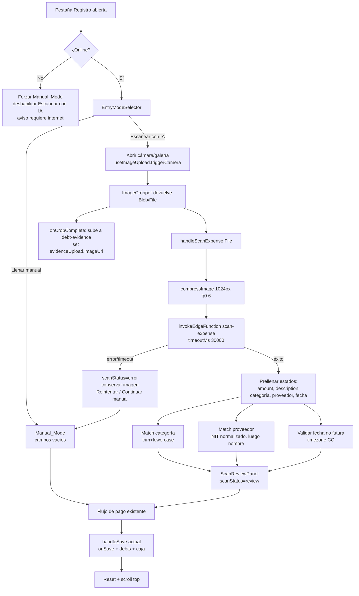

# Documento de Diseño — Escaneo de Gasto con IA

## Overview

Esta funcionalidad incorpora escaneo de comprobantes con IA al componente `components/expense/ExpenseRegister.tsx`. Dentro de la pestaña "Registro", el usuario elige entre dos modos de entrada: **Escanear con IA** (toma/selecciona una foto del recibo y la IA prellena los campos) o **Llenar manual** (flujo actual sin cambios). La misma imagen capturada para escanear se reutiliza como evidencia del gasto, evitando una doble captura.

El procesamiento de IA se hace con una **nueva edge function `scan-expense`** (Deno + Gemini 2.5 Flash), independiente de `scan-invoice`. A diferencia de `scan-invoice` —que devuelve una tabla de productos para inventario— `scan-expense` devuelve un **total único**, una **descripción corta**, una **categoría sugerida** (entre las existentes o una nueva), el **proveedor** (nombre + NIT) y la **fecha** del comprobante. El matching de categoría y proveedor contra los datos del negocio se hace en el frontend, donde están los hooks `useExpenses` y `useSuppliers`.

### Decisiones clave de diseño

| Decisión | Razón |
|----------|-------|
| Edge function nueva `scan-expense` en lugar de reutilizar `scan-invoice` | `scan-invoice` extrae líneas de productos (descripción/cantidad/costo) para inventario; un gasto necesita un total agregado y una categoría, conceptos que no existen en el contrato de factura. Separarlas evita romper inventario (Req 12.5). |
| Matching de categoría/proveedor en el **frontend** | Los hooks `useExpenses`/`useSuppliers` ya tienen los datos cargados y normalizados; la IA solo devuelve texto crudo. Mantiene la edge function sin estado y sin acceso a BD. |
| Reutilizar `useImageUpload(null, 'debt-evidence')` (ya presente en el componente) | Evita duplicar lógica de cámara, recorte, compresión y subida; la imagen escaneada y la evidencia son la misma (Req 3.2, 3.3). |
| Captura única: el `File` del cropper alimenta **escaneo + subida** | Cumple "no fotografiar dos veces" (Req 3) sin cambiar el pipeline de subida existente. |
| Extraer subcomponentes (`EntryModeSelector`, `ScanReviewPanel`) | `ExpenseRegister.tsx` ya tiene ~700 líneas; agregar el flujo inflaría el archivo. Respeta `react-patterns.md`. |
| Sin cambios de esquema en BD | Verificado vía MCP (`list_tables`, project `hjjmwipqquynjopkswvu`): `expenses.receipt_url`, `expense_categories`, `suppliers.nit` ya existen. Ver sección Data Models. |

## Architecture

### Componentes y responsabilidades

```
┌─────────────────────────────────────────────────────────────┐
│                  ExpenseRegister.tsx                         │
│  (orquestador: estado, modos, handlers, handleSave actual)   │
│                                                              │
│  entryMode: 'selector' | 'scan' | 'manual'                   │
│  scanStatus: 'idle' | 'scanning' | 'review' | 'error'        │
│                                                              │
│  ┌────────────────┐  ┌──────────────────┐  ┌─────────────┐  │
│  │ EntryModeSelector│ │  ScanReviewPanel │  │  (flujo de  │  │
│  │  (2 tarjetas)   │  │ (campos detectados│  │   pago      │  │
│  │                 │  │  + acciones)     │  │  existente) │  │
│  └────────────────┘  └──────────────────┘  └─────────────┘  │
│                                                              │
│  Hooks reutilizados: useImageUpload('debt-evidence'),        │
│  useExpenses, useSuppliers, useCashRegister, useDebts        │
└───────────────────────────┬─────────────────────────────────┘
                            │ compressImage + invokeEdgeFunction
                            ▼
┌─────────────────────────────────────────────────────────────┐
│         Edge Function: scan-expense (Deno)                   │
│  verify_jwt=false · CORS · retry backoff · responseSchema    │
│                                                              │
│  body: { imageBase64, mimeType, categories[], suppliers[] }  │
│                      │                                       │
│                      ▼                                       │
│            Gemini 2.5 Flash (Vision)                         │
│         responseMimeType: application/json                   │
│                      │                                       │
│                      ▼                                       │
│  { amount, description, suggestedCategory,                   │
│    supplierName, nit, date }                                 │
└─────────────────────────────────────────────────────────────┘
```

### Flujo de datos del escaneo (Mermaid)



## Components and Interfaces

### 1. Edge Function `scan-expense`

Ubicación: `supabase/functions/scan-expense/index.ts`. Patrón idéntico a `scan-invoice` (CORS, `verify_jwt=false`, retry con backoff exponencial para 429/503/502, `responseMimeType: "application/json"` + `responseSchema`, `temperature: 0.1`, modelo `gemini-2.5-flash`).

#### Contrato — Request

```ts
POST /functions/v1/scan-expense
Content-Type: application/json

{
  imageBase64: string;   // base64 sin prefijo data:, obligatorio
  mimeType: string;      // "image/jpeg" | "image/png" | "image/heic", obligatorio
  categories: string[];  // Existing_Categories del negocio (useExpenses.categories)
  suppliers: { name: string; nit: string }[]; // lista de proveedores (useSuppliers)
}
```

#### Contrato — Response (éxito, HTTP 200)

```ts
{
  amount: number;            // total a pagar, formato americano (punto decimal), > 0
  description: string;       // descripción corta del gasto para observaciones
  suggestedCategory: string; // categoría existente (texto original) o nueva propuesta
  supplierName: string;      // nombre del proveedor tal como aparece (puede ser "")
  nit: string;               // NIT tal como aparece (puede ser "")
  date: string;              // "YYYY-MM-DD" o "" si no se detecta
}
```

`responseSchema` de Gemini (todos los campos `required`, los de texto `nullable`):

```ts
{
  type: "OBJECT",
  properties: {
    amount:            { type: "NUMBER", nullable: true },
    description:       { type: "STRING", nullable: true },
    suggestedCategory: { type: "STRING", nullable: true },
    supplierName:      { type: "STRING", nullable: true },
    nit:               { type: "STRING", nullable: true },
    date:              { type: "STRING", nullable: true }  // YYYY-MM-DD
  },
  required: ["amount","description","suggestedCategory","supplierName","nit","date"]
}
```

#### Contrato — Errores

| Caso | HTTP | Body | Requisito |
|------|------|------|-----------|
| Falta `imageBase64` o `mimeType` | 400 | `{ error: "La imagen es obligatoria" }` (sin invocar a Gemini) | 12.7 |
| Gemini falla tras reintentos | 200 | `{ error: "Error al procesar la imagen con IA", details }` | 9.3, 12.4 |
| JSON de Gemini no parseable | 200 | `{ error: "No se pudo parsear la respuesta de IA", rawContent }` | 12.4 |
| Imagen ilegible / no es comprobante | 200 | `{ error: "No se pudo leer el comprobante" }` (el prompt instruye devolver error explícito) | 12.4 |
| Error interno no controlado | 500 | `{ error: "Error interno del servidor" }` | — |

> El wrapper `invokeEdgeFunction` interpreta `data.error` como excepción (lanza `Error(data.error)`), por lo que cualquier `{ error }` con HTTP 200 se propaga al frontend como error amigable.

#### Prompt (resumen del contenido)

El prompt instruye a Gemini como experto en lectura de recibos/facturas de gasto colombianos y le pide:

1. **`amount`**: extraer el **TOTAL a pagar** del comprobante (no subtotales ni líneas individuales). Interpretar **formato latino** (punto = miles, coma = decimales) y devolver número en formato americano. Ej.: `"15.000"` → `15000`, `"1.250,50"` → `1250.50`. Debe ser un número `> 0`.
2. **`description`**: una descripción corta del gasto (p. ej. "Compra de aseo", "Servicio de transporte") apta para el campo Observaciones.
3. **`suggestedCategory`**: recibe la lista `categories`. Si el gasto encaja con una existente (comparación flexible, insensible a mayúsculas/espacios), devolver **esa categoría con su texto original**. Si ninguna aplica, **proponer una categoría nueva** breve en mayúsculas.
4. **`supplierName`** y **`nit`**: extraer el emisor del comprobante y devolverlos **tal cual** (el matching lo hace el frontend). Si no hay, devolver `""`.
5. **`date`**: la fecha del comprobante en `YYYY-MM-DD`. Si no se detecta, `""`.
6. Si la imagen no es legible o no es un comprobante, devolver el objeto con campos vacíos/0 y el prompt agrega marca de baja confianza (el frontend trata `amount<=0` como "no detectado").

La lista `categories` y `suppliers` se inyectan en el prompt como contexto para mejorar la coincidencia.

#### Configuración / Seguridad

- `verify_jwt = false` (igual que `scan-invoice`; se invoca con la anon key vía `supabase.functions.invoke`).
- `GEMINI_API_KEY` se lee de `Deno.env.get("GEMINI_API_KEY")` (secret en Supabase Edge Functions). No se expone al cliente.
- CORS abierto (`Access-Control-Allow-Origin: *`) con manejo de `OPTIONS`.
- Timeout efectivo de 30 s coordinado con el frontend (`invokeEdgeFunction(..., { timeoutMs: 30000 })`, Req 9.3/12.6).

### 2. Frontend — `ExpenseRegister.tsx`

#### Nuevos estados

```ts
type EntryMode = 'selector' | 'scan' | 'manual';
type ScanStatus = 'idle' | 'scanning' | 'review' | 'error';

const [entryMode, setEntryMode] = useState<EntryMode>('selector');
const [scanStatus, setScanStatus] = useState<ScanStatus>('idle');
const [scanError, setScanError] = useState<string>('');
const [isOnline, setIsOnline] = useState<boolean>(() => navigator.onLine);
// Categoría nueva sugerida por IA pendiente de crear (Req 5.5)
const [suggestedNewCategory, setSuggestedNewCategory] = useState<string>('');
// Datos de proveedor detectado sin match, para prefill del modal (Req 6.6)
const [detectedSupplier, setDetectedSupplier] = useState<{ name: string; nit: string } | null>(null);
```

#### Detección online/offline

Se añade un `useEffect` que registra listeners `online`/`offline` (con cleanup) y actualiza `isOnline`. Si `isOnline` pasa a `false`:
- Si `entryMode === 'selector'`, se fuerza `manual` (Req 10.1).
- La tarjeta "Escanear con IA" del selector se renderiza deshabilitada con aviso (Req 10.1, 10.2).
- Si estaba en `scan` con datos prellenados, se conserva todo y se permite continuar en manual (Req 10.4).

#### Nuevos handlers

```ts
// Activa el modo escaneo y dispara la cámara reutilizando useImageUpload
const handleSelectScanMode = () => { setEntryMode('scan'); evidenceUpload.triggerCamera(); };

const handleSelectManualMode = () => setEntryMode('manual');

// Vuelve al selector; si hay datos/imagen, pide confirmación (Req 1.6)
const handleBackToSelector = async () => { /* confirmAction si dirty → resetForm */ };

// Núcleo del escaneo (Req 3,4,5,6,7,9)
const handleScanExpense = async (file: File) => {
  setScanStatus('scanning');
  try {
    const { base64, mimeType } = await compressImage(file);
    const { data, error } = await invokeEdgeFunction('scan-expense', {
      imageBase64: base64, mimeType,
      categories,
      suppliers: suppliers.map(s => ({ name: s.name, nit: s.nit || '' })),
    }, { timeoutMs: 30000 });
    if (error || !data || data.error) { setScanError(error || data?.error); setScanStatus('error'); return; }
    applyDetectedFields(data);     // matching + prefill
    setScanStatus('review');
  } catch (e) {
    setScanError('No se pudo procesar la imagen.'); setScanStatus('error');
  }
};

const handleRetryScan = () => evidenceUpload.triggerCamera();      // Req 9.4
const handleContinueManualFromScan = () => setEntryMode('manual'); // Req 9.4, 9.5
const handleCreateSuggestedCategory = async () => { /* addCategory + select */ }; // Req 5.5
```

#### Integración con `useImageUpload` (captura única)

El hook expone `onCropComplete(blob)`. En modo escaneo se necesita el `File` original para mandarlo a `compressImage`. Estrategia:

- Se mantiene `evidenceUpload = useImageUpload(null, 'debt-evidence')` (ya existente).
- Se agrega un wrapper local `handleCropCompleteForScan(blob, removeBg?)` que:
  1. Llama a `evidenceUpload.onCropComplete(blob, removeBg)` → sube la evidencia y setea `imageUrl` (Req 3.2, 3.3).
  2. Si `entryMode === 'scan'` y `scanStatus !== 'review'`, construye un `File` desde el `blob` y llama `handleScanExpense(file)` (Req 3.1 captura + escaneo de la misma imagen).
- `EvidenceUploader` se renderiza pasándole `onCropComplete={handleCropCompleteForScan}` en lugar del `onCropComplete` directo del hook. El resto de props del hook (`triggerCamera`, `triggerGallery`, `showInAppCamera`, etc.) se pasan sin cambios.

Así una sola captura alimenta subida de evidencia y escaneo, sin tocar el pipeline interno del hook.

#### Lógica de prellenado `applyDetectedFields(data)`

```ts
const applyDetectedFields = (d: ScanExpenseResult) => {
  // amount (Req 4.1, 4.2, 4.4)
  if (typeof d.amount === 'number' && d.amount >= 0.01 && d.amount <= 999_999_999.99) {
    setAmount(String(Math.round(d.amount))); // el input usa enteros con separador de miles
  } else { setAmount(''); }

  // description (Req 4.3)
  setDescription((d.description || '').slice(0, 500));

  // categoría (Req 5.2, 5.4, 5.5, 5.6)
  const match = categories.find(c => norm(c) === norm(d.suggestedCategory));
  if (match) { setSelectedCategory(match); setSuggestedNewCategory(''); }
  else if (d.suggestedCategory?.trim()) { setSelectedCategory(''); setSuggestedNewCategory(d.suggestedCategory.trim()); }
  else { setSelectedCategory(''); setSuggestedNewCategory(''); }

  // proveedor (Req 6.3, 6.4, 6.5, 6.6)
  const byNit = d.nit ? suppliers.find(s => normNit(s.nit) && normNit(s.nit) === normNit(d.nit)) : undefined;
  const byName = !byNit && d.supplierName ? suppliers.find(s => norm(s.name) === norm(d.supplierName)) : undefined;
  const supplier = byNit || byName;
  if (supplier) { setCreditorName(supplier.name); setDetectedSupplier(null); }
  else if (d.supplierName?.trim() || d.nit?.trim()) { setDetectedSupplier({ name: d.supplierName || '', nit: d.nit || '' }); }
  else { setDetectedSupplier(null); }

  // fecha (Req 7.2, 7.3) — no futura en zona CO; si inválida o futura → hoy
  const today = getLocalDateValue();
  setExpenseDate(isValidPastDate(d.date, today) ? d.date : today);
};

// Helpers de normalización
const norm = (s?: string) => (s || '').trim().toLowerCase();
const normNit = (s?: string) => (s || '').replace(/[\s-]/g, '');
```

`isValidPastDate(d, today)` valida que `d` sea una fecha de calendario real (`YYYY-MM-DD`, mes/día válidos) y `<= today` (comparación de strings ISO, segura para igualdad de día en zona CO porque `getLocalDateValue()` ya entrega la fecha local del negocio).

#### Orden visual (Req 2)

```
┌──────────── Pestaña REGISTRO ────────────┐
│ [Volver a elegir modo]  (en scan/manual) │
│ ┌──────────────────────────────────────┐ │
│ │ 1. EVIDENCIA / ESCANEO (EvidenceUploader)│ ← primero
│ └──────────────────────────────────────┘ │
│ ┌──────────────────────────────────────┐ │
│ │ 2. CAMPOS DETECTADOS (editables)     │ │
│ │    Fecha · Valor · Categoría ·       │ │
│ │    Observaciones · Proveedor         │ │
│ └──────────────────────────────────────┘ │
│ ┌──────────────────────────────────────┐ │
│ │ 3. FLUJO DE PAGO (sin cambios)       │ │ ← último
│ │    Contado/Crédito · ¿sale de caja? ·│ │
│ │    método de pago · Confirmar        │ │
│ └──────────────────────────────────────┘ │
└───────────────────────────────────────────┘
```

#### Subcomponentes propuestos

**`components/expense/EntryModeSelector.tsx`**

```ts
interface EntryModeSelectorProps {
  scanDisabled: boolean;           // true en offline (Req 10.1)
  offlineNotice: boolean;          // muestra aviso "requiere internet" (Req 10.2)
  onSelectScan: () => void;
  onSelectManual: () => void;
}
```

Dos tarjetas accesibles (`tabIndex={0}`, `aria-label`, `onKeyDown`). La de escaneo se ve atenuada y no clickable cuando `scanDisabled`.

**`components/expense/ScanReviewPanel.tsx`** (opcional; encapsula el bloque de campos detectados y acciones de IA)

```ts
interface ScanReviewPanelProps {
  scanStatus: ScanStatus;
  scanError: string;
  suggestedNewCategory: string;
  detectedSupplier: { name: string; nit: string } | null;
  onRetry: () => void;
  onContinueManual: () => void;
  onCreateSuggestedCategory: () => void;
  onCreateDetectedSupplier: () => void;
}
```

Muestra el spinner (`scanning`), el banner de error con acciones Reintentar/Continuar manual (`error`), el botón "Crear categoría X" y el CTA para crear el proveedor detectado. Los inputs de valor/observaciones/categoría/proveedor/fecha se mantienen en `ExpenseRegister` (estado compartido) y se reordenan según Req 2.

> Ambos subcomponentes reciben handlers ya creados con prefijo `handle` y props primitivas (sin objetos inline), conforme a `react-patterns.md`.

## Data Models

No se requieren cambios de esquema. Verificado vía MCP (`list_tables`, project `hjjmwipqquynjopkswvu`):

**`expenses`** (ya existe, se reutiliza vía `onSave` del padre):
- `amount numeric`, `description text`, `category text`, `payment_method text`, `receipt_url text`, `expense_date date`, `business_id`, `created_by`, `created_at`.

**`expense_categories`** (ya existe; `useExpenses` lee/crea con `addCategory`):
- `id`, `business_id`, `name text`, `is_active`.

**`suppliers`** (ya existe; `useSuppliers` provee `nit`):
- `id`, `business_id`, `name`, `nit text`, `phone`, `address`, `current_debt`, `invoice_config`.

**`business_debts`** y **`debts`**: se crean igual que en el flujo manual (`createDebt`, `recordPurchase`), incluyendo `evidence_url` con la URL de la evidencia (Req 11.3).

**Tipo TypeScript del resultado de escaneo (frontend):**

```ts
interface ScanExpenseResult {
  amount: number;
  description: string;
  suggestedCategory: string;
  supplierName: string;
  nit: string;
  date: string; // YYYY-MM-DD | ""
  error?: string;
}
```


## Correctness Properties

*Una propiedad es una característica o comportamiento que debe cumplirse en todas las ejecuciones válidas del sistema — esencialmente, una afirmación formal sobre lo que el sistema debe hacer. Las propiedades sirven de puente entre las especificaciones legibles por humanos y las garantías de corrección verificables por máquina.*

El escaneo de gasto tiene una capa de **lógica pura** claramente testeable con property-based testing: normalización de montos en formato latino, prellenado por rango, truncado de texto, matching de categoría y proveedor, y validación de fecha. Estas funciones se diseñan como funciones puras (entrada → salida) para poder probarlas con generadores. La integración con Gemini, Storage y la UI se cubre con pruebas de ejemplo/integración (ver Testing Strategy).

### Property 1: Normalización de monto en formato latino

*Para todo* número decimal `n` en el rango `[0.01, 999999999.99]`, al representarlo en formato latino (punto como separador de miles, coma como separador de decimales) y pasarlo por la función de normalización, el resultado debe ser igual a `n` (dentro de una tolerancia de 0.01). Para toda cadena que no represente un número válido, la normalización debe producir 0 o señalar "no numérico".

**Validates: Requirements 4.1, 12.3**

### Property 2: Prellenado de monto por rango

*Para todo* valor `amount` devuelto por el escaneo, si `amount` es numérico y `0.01 <= amount <= 999999999.99`, entonces el campo "Valor" queda con ese monto; en cualquier otro caso (no numérico, `< 0.01` o `> 999999999.99`), el campo "Valor" queda vacío.

**Validates: Requirements 4.2, 4.4**

### Property 3: Truncado de la descripción

*Para toda* cadena de texto devuelta en `description`, el valor prellenado en "Observaciones" tiene a lo sumo 500 caracteres y es un prefijo de la cadena original.

**Validates: Requirements 4.3**

### Property 4: Matching de categoría

*Para toda* lista de categorías existentes y toda categoría sugerida, la lógica de matching cumple: (a) si la sugerida coincide con alguna existente ignorando mayúsculas/minúsculas y espacios al inicio/fin, se selecciona esa categoría con su **texto original** y no queda categoría nueva pendiente; (b) si no coincide con ninguna y no está vacía, no se selecciona categoría y la sugerida queda registrada como categoría nueva pendiente de crear; (c) si está vacía, no se selecciona ninguna categoría ni queda pendiente.

**Validates: Requirements 5.2, 5.4, 5.5, 5.6**

### Property 5: Matching de proveedor por NIT y nombre

*Para toda* lista de proveedores (con nombre y NIT) y todo par detectado `(supplierName, nit)`, la lógica de matching cumple: (a) si `nit` coincide con el NIT de algún proveedor ignorando espacios y guiones, se selecciona ese proveedor (prioridad NIT); (b) si no hay coincidencia por NIT pero `supplierName` coincide con el nombre de algún proveedor ignorando mayúsculas/minúsculas y espacios al inicio/fin, se selecciona ese proveedor; (c) si no hay coincidencia por NIT ni por nombre y hay algún dato detectado, no se selecciona proveedor y los datos detectados quedan disponibles para crear uno nuevo.

**Validates: Requirements 6.3, 6.4, 6.5**

### Property 6: Validación de fecha no futura

*Para toda* cadena `date`, la fecha prellenada en "Fecha" cumple: si `date` es una fecha de calendario real en formato `YYYY-MM-DD` y es igual o anterior a la fecha actual en la zona horaria colombiana, se usa `date`; en cualquier otro caso (fecha futura, formato/fecha inválida o vacía) se usa la fecha actual en la zona horaria colombiana.

**Validates: Requirements 7.2, 7.3**

### Property 7: Equivalencia de guardado entre escaneo y manual

*Para todo* conjunto de valores finales del formulario (valor, descripción, categoría, proveedor, fecha, tipo contado/crédito, pagos, evidencia), confirmar el gasto produce los mismos registros (argumentos de `onSave` sobre `expenses`, creación de `debts`/`business_debts`, movimientos de caja, incluyendo `receipt_url` y `evidence_url`) sin importar si los valores se obtuvieron por escaneo o se ingresaron manualmente.

**Validates: Requirements 11.1, 11.3**

## Error Handling

### Edge function `scan-expense`

| Situación | Manejo | HTTP |
|-----------|--------|------|
| Falta imagen (`imageBase64`/`mimeType`) | Retorna `{ error: "La imagen es obligatoria" }` sin invocar a Gemini (Req 12.7) | 400 |
| Gemini responde 429/503/502 | Reintento con backoff exponencial (hasta 4 intentos, `2^n * 1500ms + jitter`) | — |
| Gemini agota reintentos | `{ error: "Error al procesar la imagen con IA", details }` | 200 |
| JSON de Gemini no parseable | `{ error: "No se pudo parsear la respuesta de IA", rawContent }` | 200 |
| Imagen no es comprobante | Objeto con campos vacíos/0; el frontend lo trata como "no detectado" | 200 |
| Excepción no controlada | `{ error: "Error interno del servidor" }` | 500 |

### Frontend `ExpenseRegister`

| Situación | Manejo | Requisito |
|-----------|--------|-----------|
| Error o timeout (30s) del escaneo | `scanStatus='error'`, ocultar spinner, mostrar banner con "Reintentar" y "Continuar manual"; conservar imagen capturada | 9.3, 9.4, 9.5 |
| Campo detectado inválido (monto fuera de rango, fecha futura) | Aplicar fallback (vaciar monto / usar hoy) en `applyDetectedFields` | 4.4, 7.3 |
| Categoría sugerida nueva | No seleccionar; mostrar botón "Crear categoría X" (`addCategory`) | 5.5 |
| Proveedor sin match | Mostrar CTA para crear proveedor con prefill (`createSupplier`) | 6.5, 6.6 |
| Fallo de subida de evidencia | Toast de error; conservar imagen y datos; permitir reintentar subida | 3.4 |
| Fallo de `handleSave` | Conservar formulario e imagen; toast de error; permitir reintentar (el `setIsSubmitting(false)` en `finally` ya lo permite) | 11.5 |
| Sin conexión | Deshabilitar escaneo, forzar manual, aviso visible; registro manual vía `offlineQueue` existente | 10.1, 10.2, 10.3 |
| Pérdida de conexión durante escaneo con datos | Conservar imagen y campos; permitir continuar manual | 10.4 |

Los mensajes de error de la edge function se mapean en `utils/invokeEdgeFunction.ts`: se debe **agregar `'scan-expense'`** al objeto `FUNCTION_ERRORS` (p. ej. `'No se pudo leer el comprobante. Intenta con una foto más clara.'`) y al array `scanFunctions` para que aplique el manejo específico de errores de IA y timeout.

## Testing Strategy

### Enfoque dual

- **Pruebas de propiedad (PBT)**: validan las 7 propiedades de la capa de lógica pura (normalización, prellenado, truncado, matching, validación de fecha, equivalencia de guardado). Estas funciones se extraen como funciones puras y exportables (p. ej. en `components/expense/scanExpense.logic.ts`) para poder testearlas aisladas de React.
- **Pruebas de ejemplo (unit)**: transiciones de modo (selector/scan/manual), render del `EntryModeSelector`, orden visual, estados de carga/error, confirmación al descartar, editabilidad de campos, wiring del payload de escaneo.
- **Pruebas de integración**: subida a `debt-evidence` (Storage, con mock) y shape de respuesta de la edge function (1-2 invocaciones).
- **Smoke**: verificación del límite de 30s y rechazo 400 sin imagen en la edge function.

### Configuración de PBT

- Librería: **fast-check** (ecosistema TypeScript/Vitest del proyecto). No se implementa PBT desde cero.
- Mínimo **100 iteraciones** por prueba de propiedad.
- Cada prueba de propiedad lleva un comentario con la etiqueta de trazabilidad:
  `// Feature: escaneo-gasto-ia, Property {n}: {texto de la propiedad}`
- Cada propiedad del diseño se implementa con **una sola** prueba de propiedad.

### Mapeo propiedad → función pura bajo prueba

| Propiedad | Función pura | Generadores |
|-----------|-------------|-------------|
| P1 | `normalizeLatinAmount(str)` | decimales en rango + formateo latino; cadenas basura |
| P2 | `resolveAmountField(amount)` | `fc.double`, incluyendo fuera de rango y `NaN` |
| P3 | `truncateDescription(str)` | cadenas de longitud arbitraria (incl. > 500) |
| P4 | `matchCategory(categories, suggested)` | listas de categorías + variaciones de casing/espacios y valores fuera de lista/vacíos |
| P5 | `matchSupplier(suppliers, {name, nit})` | proveedores con NIT/nombre + variaciones con espacios/guiones/casing y sin match |
| P6 | `resolveExpenseDate(date, today)` | fechas válidas pasadas/futuras, inválidas y vacías |
| P7 | `buildExpensePayload(finalValues)` | conjuntos de valores finales (contado/crédito, pagos, evidencia) comparando modo scan vs manual |

### No-regresión

Las pruebas existentes del flujo manual de `ExpenseRegister` (validaciones de pago, caja, crédito) deben seguir pasando sin cambios, confirmando los requisitos 2.4, 8.3, 11.2 y 12.5 (independencia de `scan-invoice`).
